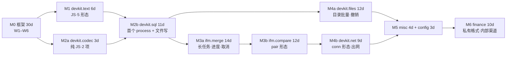

# IFM 工具箱插件化 — 实施集成计划

> 状态：**实施计划（已核对范围，未动代码）**
> 前置：`docs/ifm-plugin-port-design.md`（范围与协议）、`docs/ifm-plugin-ui-design.html`（逐工具界面）
> 核对记录：`docs/ifm-ui-review-2026-10-18.json`（34 合理 / 3 收窄 / 10 不迁）
> 源仓：`/Users/bws/code/code/github/ifm_ai_tools`（Tauri 2 + Vue 3，88 工具）
> 口径：**57 → 50 个工具 → 37 个界面 → 10 个插件包**，L1 15 / L2 22；不迁 38 项

---

## 0. 一页结论

三条主线，顺序不可颠倒：

1. **M0 宿主框架**（30 人日）— 让「一个工具」在宿主里能跑完整闭环：声明 `[io]` → 渲染操作区 → 传输入 → 收结果 → 展示 → 取消 → 留痕。不做这一步，后面 37 个界面全是剪贴板玩具。
2. **M1 纯 JS 包**（6 人日）— `devkit.text` 覆盖 split/list/form/table/preview **五种形态**，用一个包把渲染器矩阵验完，代价最低。
3. **M2 起 process 轨**（84 人日）— `devkit.codec` 只剩 2 个纯 JS 工具（原定的 protobuf 探针已裁撤），因此**首个真机 process 工具改在 `devkit.sql` 的 `script-check`**（只读目录 → 问题表），再按「写文件 → 长任务 → 网络 → 私有格式」逐级放大权限。

合计 **114 人日**（≈ 单人 23 周 / 双人 12 周）。

**关键判断：先窄后宽，不要先做价值最高的包。** `ifm.merge` 业务价值最高，但它同时依赖目录授权、进度、取消、日志、产物落盘五件事——框架没验过就上，失败时无法区分「协议错」还是「移植错」。

---

## 1. 不变项（红线，任何阶段都不碰）

| 项 | 约束 |
| --- | --- |
| 邮件 / 数据库 / Redis / SSH 四域 | 一个工具都不迁，含 SSH 衍生的 6 个运维工具（部署/集群/应用中心/集群日志/上线检查清单） |
| beta / dev 标记工具 | 不迁（12 项，含造数全家桶） |
| `ToolCategory` 枚举 | 不加档位，ifm 的 15 类改用 `group` 二级分组承载 |
| 内置工具 | 不新增内置实现，一律走插件；`duck-tools` 只保留注册表机制 |
| 依赖快照 | `gpui-base` / `gpui-component` / `gpui-kit-assets` 保持 `=` 钉死；不引回 `keyring` |
| MSRV | 1.85；源仓 `rust-version = 1.93`，移植代码逐个 `cargo +1.85 check` |
| i18n | 宿主源码中文串进 `en.toml`；插件文案进 `<plugin>/locales/`；终态跑 `cargo test -p duck-theme` |

---

## 2. 宿主现状：14 个缺口，逐条有证据

| # | 缺口 | 现状证据 | 后果 |
| --- | --- | --- | --- |
| 1 | 执行时无输入 | `plugins.rs` `run_plugin_tool` 传 `""` | 纯文本工具只能读剪贴板 |
| 2 | 产出只弹 toast | `emit_outcome`（超 240 字截断） | 表格/树/diff 无处展示 |
| 3 | wasm/process 未接入 | `plugins.rs:403` → `run_placeholder` | 42 个系统级工具无执行通道 |
| 4 | 无参数/无表单 | `ToolContribution` 只有 id/name/description/category/icon/keywords | 语言选择、目录选择、开关全丢失 |
| 5 | 无 `[io]` 声明 | `manifest.rs` 无对应字段 | 宿主不知道「这个工具要什么、给什么」 |
| 6 | group/beta/dev 未映射 | `register_tools` 未调用 `.group()/.beta()/.dev()`（`ToolMeta` 字段已存在，`meta.rs:41`） | 37 个界面挤在一个分类里 |
| 7 | 文件能力只覆盖 `dataDir` | 能力 glob 语义相对插件数据目录 | 合并/比对是目录级操作，用不了 |
| 8 | JS 10 秒上限、无进度、不可取消 | `duck-plugin-js` `TIME_LIMIT` | 长任务到点被掐 |
| 9 | 无插件 KV | — | hosts 方案、连接列表、规则模板无处存 |
| 10 | 无通用执行页 | `toolbox.rs: render_workspace_canvas` 是空态占位 | 44 张设计稿没有落点 |
| 11 | 无结果渲染器 | 无 table/tree/diff/log 组件 | 同上 |
| 12 | 审计只记成功/失败 | `record_event` 无耗时、无产物大小 | 长任务无法追责 |
| 13 | 打包不含插件 | `sbin/package-macos.sh` 只拷 `MacOS` + `AppIcon.icns` | release 包首启为空 |
| 14 | process 二进制无签名策略 | 打包脚本只签 `.app` | 下载的插件带 quarantine，Gatekeeper 拦 |

---

## 3. 架构决策（六条，按此实现，不再讨论）

### ADR-1　执行页由 `[io]` 声明驱动，不写 37 个页面

插件在 `plugin.toml` 声明「输入字段 + 参数 + 输出形状」，宿主用**一套**通用执行页渲染。37 个界面 = 同一页面的 37 份数据。

- 收益：新工具零 UI 成本；行为一致（键盘、复制、空态、错误态只写一次）；i18n 只走插件表。
- 代价：表达力有上限（7 种形态 + 6 类参数）。套不进任何形态的工具，就是不该迁的工具。

```toml
[[tools]]
id = "duck.devkit.text.formatter"
name = "格式化"
category = "text"
group = "代码与文本"

[tools.io]
allow_files = "read"            # none | read | read_write（运行时授权，不是 glob）

[[tools.io.fields]]
id = "input"
kind = "textarea"
label = "输入"
placeholder = "粘贴代码或拖入文件…"
required = true

[[tools.io.params]]
id = "lang"
kind = "select"
label = "语言"
default = "auto"
options = [{ value = "auto", label = "自动识别" }, { value = "json", label = "JSON" }]

[[tools.io.params]]
id = "minify"
kind = "switch"
label = "压缩输出"

[[tools.io.output]]
kind = "code"                   # text | code | table | tree | diff | log
label = "结果"
```

### ADR-2　只做两条轨：`js` 与 `process`，**wasm 不做**

| 轨 | 承载 | 判据 |
| --- | --- | --- |
| `js` | 纯函数（格式化、编码、哈希、生成、正则） | 无文件系统、无子进程、< 10s |
| `process` | 一切需要文件/网络/长任务的工具 | 有产物、有进度、可取消 |

wasm 现无实现且没有工具需要它（需要 wasm 的场景都能被 process 覆盖），做了就是三套协议两套测试。**明确放弃**，`execution_model = "wasm"` 保留解析但给「未支持的执行模型」提示。

### ADR-3　文件访问 = 运行时授权，per-run

- `capabilities.filesystem_*` 只管插件**自己的** `dataDir`（现状不变）。
- 用户文件通过 `[io]` 的 `path` 字段选择，宿主把**绝对路径**写进本次运行请求，**只对本次生效**。
- 授权提示列在运行按钮旁：「本次将读取 3 个路径」。不弹 modal，不写 kv，不记忆。
- process 轨无法在内核级沙箱（子进程有完整 OS 权限），因此：**首次运行确认 + 清单哈希校验 + 审计留痕**三层，而不是假装能隔离。

### ADR-4　插件 KV = 快照传入 + 写入回执

`duck-plugin-js` 是零 gpui 的后台执行器，不能直连 `duck-store`（会破分层 + 跨线程）。

- 运行前：宿主读 `kv: plugin_kv::<plugin_id>` → 传 `BTreeMap<String,String>` 快照。
- 运行后：插件返回 `kv_writes: [(key, value)]` → 宿主校验（单插件 ≤ 32 KB、key ≤ 64 字符）→ `kv_put` + `flush`。
- 好处：无锁、无跨线程 store、崩溃时最多丢一次写入。

### ADR-5　`[io]` 不进 `ToolMeta`，渲染期从 `PluginIndex` 取

`ToolMeta` 全是 `&'static str`，`[io]` 是 owned 数据且要按语言取词。烘进去就得 `leak_str` + 重建注册表才能切语言（本项目已踩过）。

- `PluginIndex::tool_io(tool_id) -> Option<&IoSpec>`，页面渲染时取。
- 校验：`crates/duck-plugin/src/manifest.rs` 单测 `io_is_not_baked_into_meta` 用 grep 守住。

### ADR-6　结果统一 6 种渲染器

`text`（可选中纯文本）、`code`（只读代码块 + 复制）、`table`（列定义 + 排序 + 导出 CSV）、`tree`（结构 + 详情）、`diff`（A/B 双栏 + 统计）、`log`（流式追加 + 自动滚底）。

所有渲染器共用一个外壳（工具栏 + 滚动容器 + 空态），放在 `duck-components/src/tool_output.rs`。

---

## 4. 宿主改造：六个工作包（W1–W6）

### W1　清单 `[io]` 段 + api_version 2（4 人日）

| 文件 | 改动 |
| --- | --- |
| `crates/duck-plugin/src/manifest.rs` | 新增 `[io]` 解析：`IoSpec { fields, params, output, allow_files }`；`ToolContribution` 增 `group: Option<String>` / `beta: bool` / `dev: bool` / `io: Option<IoSpec>` |
| 同文件 | `SUPPORTED_API_VERSION` 抬到 **2**，`validate` 接受 1 与 2；`[io]` 出现在 `api_version = 1` 时报错 —— 旧宿主 `deny_unknown_fields` 会直接拒绝带 `[io]` 的清单，抬版本号是为了让错误在安装期暴露，而不是运行期静默 |
| 新文件 `crates/duck-plugin/src/io.rs` | `FieldSpec` / `ParamSpec{kind: text·textarea·path·select·switch·number·range}` / `OutputSpec{kind}`，全字段 `#[serde(default)]` 向后兼容 |
| `crates/duck-plugin/src/registry.rs` | `PluginIndex::tool_io()` / `tools_of_plugin()` |
| 测试 | 4 条：最小清单可解析、`[io]` 缺 select options 报错、`api_version = 1` + `[io]` 报错、未知字段仍 `deny_unknown_fields` |

### W2　元信息映射（1 人日）

`crates/duck-app/src/plugins.rs::register_tools` 补三行：`.group(leak_str(g))` / `.beta(tool.beta)` / `.dev(tool.dev)`。分类映射表（ifm 15 类 → 宿主 7 类 + group）落在 `duck-app/src/plugins.rs` 常量表，不动 `duck-tools`。

### W3　`crates/duck-plugin-process` 新 crate（8 人日）

零 gpui、零 tokio（`std::process` + 线程 + channel）。

| 文件 | 内容 |
| --- | --- |
| `src/protocol.rs` | 请求 `{"type":"run","tool","input","params","files","lang","kv"}`；事件 `log` / `progress` / `result` / `error`；取消 `{"type":"cancel"}` + 2s 后 SIGTERM |
| `src/runner.rs` | 启动 `<plugin_dir>/bin/<name>`，stdin/stdout 双线程，`ProgressSink` 回调，`CancelToken`（`Arc<AtomicBool>` + child handle） |
| `src/lib.rs` | 入口 `run(plugin_dir, manifest, request, sink, cancel) -> Result<RunOutcome>`；复用 `duck_plugin::locale_env` 传 `DUCK_LOCALE` / `DUCK_LOCALES_DIR` |
| 硬限制 | 单行 ≤ 1 MB、总量 ≤ 8 MB、30s 无事件告警、非零退出码 → `error` 事件 + stderr 末 20 行 |
| 测试 | 用一个 `sh` 假插件覆盖：正常 result、progress 序列、取消中途、崩溃退出、超长行被拒 |

### W4　通用执行页 + 6 个渲染器（12 人日）

| 文件 | 改动 |
| --- | --- |
| 新 `crates/duck-app/src/pages/tool_run.rs` | `ToolRunView { spec, values, input, state: Idle/Running{progress,cancel}/Done/Err, result }`；状态挂 `ToolRoute`（切走不丢） |
| `crates/duck-app/src/pages/toolbox.rs` | `render_workspace_canvas` 三分支：内置工具→现状空态；插件无 `[io]`→现状「运行」按钮；插件有 `[io]`→`ToolRunView` |
| 新 `crates/duck-components/src/tool_output.rs` | 6 种渲染器 + 统一工具栏（复制/导出/行数） |
| `crates/duck-app/src/plugins.rs` | `run_plugin_tool` 改为接收 `RunRequest`；按 `execution_model` 分派到 js / process；进度回调用 `cx.defer` 投递（禁止派发期 `window.update`） |
| 布局 | 严格按 UI 稿铁律：**操作区（参数 + 执行）置顶 → 结果居中 → 输入框沉底** |
| 文件选择 | 复用 `crates/duck-app/src/file_dialogs.rs`（禁 rfd 同步模态，`runModal` 会 AppKit 重入 abort） |
| 测试 | `tests/tool_run_layout.rs`（操作区在输入框之上）、`selectable_copy.rs` 覆盖结果区、`ui_never_uses_blocking_file_dialogs.rs` 覆盖路径选择 |

### W5　插件 KV（2 人日）

`duck-plugin-js` 增 `duck.kv.get/set` 宿主函数（读快照、收集写入）；`duck-app` 侧读写 `kv: plugin_kv::<id>` + 32 KB 上限校验 + 运行后 `flush`。

### W6　审计 / 打包 / 签名（3 人日）

| 项 | 内容 |
| --- | --- |
| 审计 | `record_event` 补 3 个字段：耗时 ms、产物大小、触碰文件数；process 轨失败记退出码 |
| 打包 | `sbin/package-macos.sh` 增一步：把 `plugins/` 首批包拷进 `Contents/Resources/plugins/`，并在 `dirs.plugins()` 缺失时回落 Resources（dev 仍优先仓库 `plugins/`） |
| 签名 | process 二进制安装时 `codesign --force --sign - <bin>`（ad-hoc 重签）+ 记录 sha256；公开分发才需 Developer ID + 公证，内部渠道先走 ad-hoc |
| 备份 | `backup.rs` 已含 `plugins` 与 `plugin_data`，补一条：单包 > 50 MB 时提示「备份体积」 |

**M0 合计 30 人日**（评审稿写 15，上调原因：W4 从「一个输入框 + 一个输出框」变成 6 渲染器 + 6 控件 + 文件授权 + 导出，W3 单列成 crate，W6 新增签名/打包）。

---

## 5. 里程碑与依赖



| 里程碑 | 内容 | 出口标准 | 人日 | 可并行 |
| --- | --- | --- | --- | --- |
| M0 | 框架六件套 | 一个手写样例插件（locale + `[io]` + process）跑通全链路；取消后进程确实退出 | 30 | 否 |
| M1 | `devkit.text`（10 工具 / 9 界） | 5 种形态全部真机跑过；10 个工具 golden 全绿 | 6 | 与 M2a 并行 |
| M2a | `devkit.codec`（2 界） | 2 个纯 JS 工具可用；`crypto-bundle` 按收窄口径只留四块 | 3 | 与 M1 并行 |
| M2b | `devkit.sql`（7 工具 / 5 界） | **首个 process 工具 `script-check` 真机通过**；文件写前 Dialog 确认；问题表可跳行 | 11 | 否 |
| M3a | `ifm.merge`（2 界 / 4 工具） | 真实 SP 包合并结果与源仓逐字节一致；进度/取消可用 | 14 | 否 |
| M3b | `ifm.compare`（4 界 / 6 工具） | 差异统计与源仓一致；大包（>5000 class）不卡 UI | 12 | 与 M4a 并行 |
| M4a | `devkit.files`（5 界 / 9 工具） | 批量改名可撤销；搜索 10 万文件 < 3s | 12 | 与 M3b 并行 |
| M4b | `devkit.net`（4 界 / 6 工具） | 出网受 `network_hosts` 约束；报文可按 Hex/文本切换 | 9 | 否 |
| M5 | `devkit.misc`（2）+ `devkit.config`（2） | `s3-manager` 若为空壳则砍；`nginx-generator` 生成内容可校验 | 7 | 是 |
| M6 | `ifm.finance`（2 界） | 私有格式 fixture 覆盖 3 类真实文件；只内部渠道分发 | 10 | 否 |
| — | 合计 | — | **114 人日**（含 M0 30） | 单人 ~23 周 / 双人 ~12 周 |

---

## 6. 插件迁移顺序

### 6.1 排序依据（四条，按优先级）

1. **契约覆盖**：先做能覆盖最多页面形态的包，一次验完渲染器，避免每个包各补一次 UI。
2. **权限递增**：无 IO → 只读文件 → 写文件 → 长任务 → 网络 → 私有格式。每级只引入一种新风险。
3. **失败可定位**：新包只应引入「移植是否正确」这一个未知；协议层的问题必须在 M0/M1 暴露完。
4. **业务依赖链**：合并 → 比对是同一工作流的上下游，合并先做（产物正好是比对输入）。

### 6.2 批次表

| 序 | 包 | 界面 / 工具 | 形态覆盖 | 新增风险 | 依赖 | 人日 |
| --- | --- | --- | --- | --- | --- | --- |
| 1 | `devkit.text` | 9 / 10 | split·list·form·table·preview | 无（纯 JS） | M0 | 6 |
| 2 | `devkit.codec` | 2 / 2 | split·form | 无（纯 JS；protobuf 已裁撤） | M0 | 3 |
| 3 | `devkit.sql` | 5 / 7 | split·job·table·form | **process 协议 + 写文件 + 破坏性确认** | 1,2 | 11 |
| 4 | `ifm.merge` | 2 / 4 | job | **目录级长任务 + 进度/取消 + 产物落盘** | 3 | 14 |
| 5 | `ifm.compare` | 4 / 6 | pair·preview | 只读大包 + zip 遍历 | 4 | 12 |
| 6 | `devkit.files` | 5 / 9 | table·preview·form | **批量改名/替换（可撤销）+ 外部运行时** | 3 | 12 |
| 7 | `devkit.net` | 4 / 6 | split·**conn**·form·preview | **出网 + 凭据不落盘** | 3 | 9 |
| 8 | `devkit.misc` | 2 / 2 | split·preview | 外部命令（git） | 6 | 4 |
| 9 | `devkit.config` | 2 / 2 | form·table | 低（配置生成） | 3 | 3 |
| 10 | `ifm.finance` | 2 / 2 | preview·table | **私有格式 + 合规** | 6 | 10 |

### 6.3 逐包说明：为什么排在这里

**1. `devkit.text`（起点）**
覆盖 5/7 形态，且全是纯函数——先在无 IO、无进程、无权限的干净面上，把「声明 → 渲染 → 传参 → 收结果」验透。若协议设计有误，改一次只影响这 10 个工具。搬 `formatter.rs`（1,349 行，是唯一有 Rust 实现的重工具）+ 前端 `lib/transforms`。
顺序建议：`case-convert` → `timestamp` → `number-to-chinese` → `random-gen` → `data-format` → `formatter` → `regex-plus` → `cron-gen` → `cheat-sheets`（由简到繁，前 4 个当天可完成，用来打磨 `[io]` 字段类型；`prompt-optimizer` 已按核对结果裁撤）。

**2. `devkit.codec`（纯 JS，2 项）**
`protobuf-codec` 按核对结果裁撤后，本包只剩 `crypto-bundle`（收窄：AES-CBC / 哈希 / JWT / Base64 四块，恒生私有算法先做合规确认）与 `encoding-converter`，全部 JS。
**代价与对策**：原计划用 protobuf 做 process 协议探针，现在没有「无文件的 process 工具」了 ⇒ 探针改为 **W3 自带的 fixture 插件**（`sh` 假插件覆盖 result/progress/cancel/崩溃四类事件），首个真机 process 工具放到 `devkit.sql` 的 `script-check`（只读目录、不写盘，风险同样可控）。

**3. `devkit.sql`（首个真机 process 包）**
包内必须按此顺序：① `script-check`（只读目录 → 问题表，验证 stdin/stdout 协议与 table 渲染）→ ② `sql-merge`（写单个输出文件）→ ③ `sql-rewrite`（破坏性改写，Dialog 确认 + `.bak`）→ ④ `ddl-generator` / `sql-classifier`（纯 JS 收尾）。
这一包同时打通「文件读写 + 结果表」这条最常用的路，后面 5 个包都复用。

**4. `ifm.merge`（价值最高，放这里）**
放第 4 而不是第 1：它需要「目录授权 + 进度 + 取消 + 冲突日志 + 产物目录」五件事同时正确，M0–M2b 才能保证失败时问题出在移植而非框架。搬运成本也是最低的——`sp_merge` / `see_merge` / `ifms6_merge` 的 `tauri::command` 计数为 **0**，只需把 `AppHandle + Emitter` 换成 `ProgressSink`。合并产出的目录树正好是 `ifm.compare` 的输入。

**5. `ifm.compare`（紧接 merge）**
独立价值存在（比两个 jar），但工作流上紧接合并后。引入 `pair` 形态（diff 渲染器），并第一次处理「大包只读遍历」——`class_compare` 1,496 行 + `jar_compare` 891 行，共用 zip + class 解析。

**6. `devkit.files`（批量写操作）**
`sensitive-scanner` 已裁撤，本包只剩 5 个界面：`file-search`（文件名 + 内容，原判收窄、现按全量做遍历搜索）、`directory-tree`、`batch-edit`、`csv-tools`、`doc-convert`。
`batch-edit` 要「预览 → 确认 → 应用 → 撤销」，需要新增撤销栈（内存保留 ≤ 200 条原内容）。`doc-convert` 依赖外部 `soffice`：运行时检测一次，缺失给「安装 LibreOffice」引导而不是报错堆栈。

**7. `devkit.net`（出网）**
唯一引入 `conn` 形态。`hosts-manager` 只生成内容不写系统文件（写 `/etc/hosts` 需 sudo + 高危）；`http-request` 的 token/密码走 `vault`，不落 kv、不进日志。

**8. `devkit.misc`（只读小包）**
只剩 `json-schema-validator`（纯 JS）与 `git-tools`（`process_exec = ["git"]`）。`screenshot` / `diagram-renderer` 已按核对结果裁撤，屏幕录制授权与 SVG 渲染两条技术债一并消失。

**9. `devkit.config`（低价值收尾）**
`nginx-generator` 纯模板生成、`s3-manager` 疑似空壳（源页面 17 行，**动手前先核实**，是空壳就砍，包剩 1 项并入 `devkit.misc`）。

**10. `ifm.finance`（最后）**
只剩 `pdm-reader`（1,344 行，只读预览）与 `channel-gateway`（2,360 行）；`finance-parser` 已按核对结果裁撤，OFD/WDEP 等私有格式的解析与合规审查压力随之下降。放最后不阻塞任何主线。

### 6.4 每包内的工作顺序（统一模板）

```
① fixture 先行：在源仓跑出 3–5 组「输入 → 期望输出」，存 packages/<pkg>/fixtures/
② 抽逻辑：新建 crates/<pkg>-core（零 gpui、零 tauri），逐个工具迁，配 #[test] 比 golden
③ 写桥：bin/<pkg>.rs —— stdin JSONL → 调 core → stdout 事件；进度用 sink 上报
④ 写清单：plugin.toml（[io] 段 + group + keywords 别名）+ locales/en.toml
⑤ 宿主侧联调：真机跑 5 种形态，核对 UI 稿
⑥ 门禁：见 §8，全绿才进下一个包
```

### 6.5 反例（为什么不按「价值优先」排）

若先做 `ifm.merge`：目录授权、进度、取消、日志、产物落盘五件事一起上，一旦输出与源仓不一致，要同时怀疑协议、编码、排序、路径处理四层，联调成本约为按序推进的 3 倍。且 `merge` 无 UI 形态可复用（只有 job 一种），框架缺陷要等做到 `devkit.text` 才暴露，返工更贵。

---

## 7. 每个包的完成定义（DoD）

| # | 条件 | 验证方式 |
| --- | --- | --- |
| 1 | 该包全部工具在宿主真机可执行 | 手动清单逐条打勾 |
| 2 | golden 差分：输出与源仓逐字节一致（表格类比对排序后内容） | `cargo test -p <pkg>-core` |
| 3 | 取消在 2s 内生效，进程确实退出（无僵尸） | `ps` 检查 + 单测 |
| 4 | 长任务进度单调递增，UI 不冻结（拖动窗口流畅） | dev/release 各跑一次 |
| 5 | 插件文案覆盖：每个中文串在 `locales/en.toml` 有译文 | `python3 scripts/plugin_locales.py --strict` |
| 6 | 宿主源码零新增中文未译 | `cargo test -p duck-theme` |
| 7 | 无阻塞式文件对话框 | `cargo test -p duck-app --test ui_never_uses_blocking_file_dialogs` |
| 8 | 审计有记录（耗时、产物大小、失败原因） | 查 `audit` 表 |
| 9 | 卸载插件后工具消失、无残留注册 | 手动 + `tool_ids_of` 单测 |
| 10 | 包体积与备份影响已记录 | `du -sh plugins/<pkg>` |

---

## 8. 门禁命令（每批必跑，缺一不可）

```bash
cargo fmt --all --check
cargo clippy --workspace --all-targets
cargo test -p duck-theme                 # i18n 漏译唯一门禁
python3 scripts/i18n_en_toml.py          # 同步 en_keys.txt（有宿主中文串时）
python3 scripts/plugin_locales.py --strict
cargo test -p duck-plugin -p duck-plugin-process -p <pkg>-core
cargo tree -i gpui-base | head -1        # 必须指向 vendor/gpui-base v0.7.1
cargo +1.85 check -p <pkg>-core          # 移植代码过 MSRV
bash -n sbin/package-macos.sh            # 若改打包
```

CI 侧注意：clippy 与测试必须同作业（rust-cache 同 key 互冲）；`THIRD_PARTY_LICENSES.md` 在依赖变化后必须重生成并提交。

---

## 9. 风险与对策

| 风险 | 概率 | 影响 | 对策 |
| --- | --- | --- | --- |
| MSRV 落差（1.93 → 1.85） | 高 | 移植代码编译不过 | 每包先 `cargo +1.85 check`；`let_chains` 等新语法改写为谓词合并 |
| 依赖许可（calamine / ristretto_classfile / zip / sm4 / pdf-extract） | 中 | 卡 `deny.toml` | 每包引入前先跑 `cargo deny check licenses`；不可用则换实现或砍工具 |
| 源仓无测试基线 | 高 | 「复刻对不对」无法判定 | fixture 先行，作为每包 ① 步，不产出 fixture 不开工 |
| process 插件无法沙箱 | 确定 | 恶意插件可读写全盘 | 只从受控渠道安装 + 清单哈希 + 首次运行确认 + 审计；不承诺隔离 |
| Gatekeeper 拦未签名二进制 | 高 | 插件装了跑不起来 | 安装时 ad-hoc 重签 + 记录 sha256；公开分发前补 Developer ID 公证 |
| `[io]` 表达力不足 | 中 | 某工具塞不进 | 已预留降级：多列可编辑类（CSV 编辑/表配置）→「选文件 + 只读预览 + 导出」 |
| 大包内存（>5000 class / 10 万文件） | 中 | OOM 或卡顿 | 流式解析 + 结果上限 5 万行 + 超限提示「缩小范围」 |
| 备份体积（process 包带二进制） | 中 | 备份变慢 | 单包 > 50 MB 提示；备份默认跳过 `bin/`（可重建） |

**回滚策略**：每个包是独立目录 + 独立 crate，回滚 = 删除 `plugins/<pkg>` 目录（工具自动从注册表消失）。宿主侧 W1–W6 一次落地后不再随包变化，无需回滚。

---

## 10. 排期（单人 / 双人）

| 周 | 单人 | 双人（A：框架 → text → merge → compare；B：codec → sql → files → net） |
| --- | --- | --- |
| 1–6 | M0 | A: M0；B: 定协议、各包 fixture 先行 |
| 7 | M1 | A: M1（text）；B: M2a（codec） |
| 8 | M2a | A: M2b 起步（process 探针）；B: M2b 主攻（sql 规则引擎） |
| 9–11 | M2b | A: M2b 收尾 → M3a 起步；B: M2b 收尾 |
| 12–14 | M3a | A: M3a（合并器）；B: M4a（文件批处理） |
| 15–17 | M3b | A: M3b（比对）；B: M4a 收尾 → M4b |
| 18–20 | M4a | A: M4b（网络）；B: M5（misc + config） |
| 21–22 | M4b | A: M6（finance）；B: M6 |
| 23 | M5 | 回归、门禁、文档 |
| 24–25 | M6 | — |

> 单人 114 人日 ÷ 5 ≈ 23 周，按阶段取整约 **24 周**；双人约 **12 周**（依赖链不允许 merge 早于 sql 的 process 探针）。

---

## 11. 下一步（三步，按序）

1. **评审本计划**：确认 §1 红线、§6.2 顺序、§10 人力。有异议现在提，动了代码再改顺序成本翻倍。
2. **W1 先行出改动清单**：只改 `duck-plugin`（清单 + `[io]` + 单测），约 4 人日，可独立评审、独立回滚。
3. **写样例插件**：手写一个 `plugins/sample-io/`（1 个工具、`[io]` 三字段、en.toml），作为 M0 的验收标的与后续 all 包的模板。

> 相关文档：范围与协议 `ifm-plugin-port-design.md`；逐工具界面 `ifm-plugin-ui-design.html`（44 张卡，含「合理/需调整/移除」核对）。
