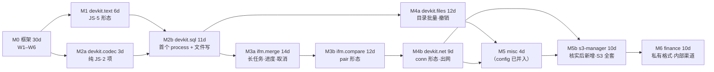

# IFM 工具箱插件化 — 实施集成计划

> 状态：**实施计划（已核对范围，未动代码）**
> 前置：`docs/ifm-plugin-port-design.md`（范围与协议）、`docs/ifm-plugin-ui-design.html`（逐工具界面）
> 核对记录：`docs/ifm-ui-review-2026-10-18.json`（34 合理 / 3 收窄 / 10 不迁）
> 源仓：`/Users/bws/code/code/github/ifm_ai_tools`（Tauri 2 + Vue 3，88 工具）
> 口径：**57 → 50 个工具 → 37 个界面 → 50 个插件（一工具一插件，7 个 id 前缀族）**，L1 15 / L2 22；不迁 38 项（见 ADR-7）

---

## 0. 一页结论

三条主线，顺序不可颠倒：

1. **M0 宿主框架**（30 人日）— 让「一个工具」在宿主里能跑完整闭环：声明 `[io]` → 渲染操作区 → 传输入 → 收结果 → 展示 → 取消 → 留痕。不做这一步，后面 37 个界面全是剪贴板玩具。
2. **M1 纯 JS 包**（6 人日）— `devkit.text` 覆盖 split/list/form/table/preview **五种形态**，用一个包把渲染器矩阵验完，代价最低。
3. **M2 起 process 轨**（84 人日）— `devkit.codec` 只剩 2 个纯 JS 工具（原定的 protobuf 探针已裁撤），因此**首个真机 process 工具改在 `devkit.sql` 的 `script-check`**（只读目录 → 问题表），再按「写文件 → 长任务 → 网络 → 私有格式」逐级放大权限。

合计 **114 人日**（≈ 单人 23 周 / 双人 12 周）。

**关键判断：先窄后宽，不要先做价值最高的包。** `ifm.merge` 业务价值最高，但它同时依赖目录授权、进度、取消、日志、产物落盘五件事——框架没验过就上，失败时无法区分「协议错」还是「移植错」。

---

## 1. 不变项（红线，任何阶段都不碰）

| 项 | 约束 |
| --- | --- |
| 邮件 / 数据库 / Redis / SSH 四域 | 一个工具都不迁，含 SSH 衍生的 6 个运维工具（部署/集群/应用中心/集群日志/上线检查清单） |
| beta / dev 标记工具 | 不迁（12 项，含造数全家桶） |
| `ToolCategory` 枚举 | 不加档位，ifm 的 15 类改用 `group` 二级分组承载 |
| 内置工具 | 不新增内置实现，一律走插件；`duck-tools` 只保留注册表机制 |
| 依赖快照 | `gpui-base` / `gpui-component` / `gpui-kit-assets` 保持 `=` 钉死；不引回 `keyring` |
| MSRV | 1.85；源仓 `rust-version = 1.93`，移植代码逐个 `cargo +1.85 check` |
| i18n | 宿主源码中文串进 `en.toml`；插件文案进 `<plugin>/locales/`；终态跑 `cargo test -p duck-theme` |

---

## 2. 宿主现状：14 个缺口，逐条有证据

| # | 缺口 | 现状证据 | 后果 |
| --- | --- | --- | --- |
| 1 | 执行时无输入 | `plugins.rs` `run_plugin_tool` 传 `""` | 纯文本工具只能读剪贴板 |
| 2 | 产出只弹 toast | `emit_outcome`（超 240 字截断） | 表格/树/diff 无处展示 |
| 3 | wasm/process 未接入 | `plugins.rs:403` → `run_placeholder` | 42 个系统级工具无执行通道 |
| 4 | 无参数/无表单 | `ToolContribution` 只有 id/name/description/category/icon/keywords | 语言选择、目录选择、开关全丢失 |
| 5 | 无 `[io]` 声明 | `manifest.rs` 无对应字段 | 宿主不知道「这个工具要什么、给什么」 |
| 6 | group/beta/dev 未映射 | `register_tools` 未调用 `.group()/.beta()/.dev()`（`ToolMeta` 字段已存在，`meta.rs:41`） | 37 个界面挤在一个分类里 |
| 7 | 文件能力只覆盖 `dataDir` | 能力 glob 语义相对插件数据目录 | 合并/比对是目录级操作，用不了 |
| 8 | JS 10 秒上限、无进度、不可取消 | `duck-plugin-js` `TIME_LIMIT` | 长任务到点被掐 |
| 9 | 无插件 KV | — | hosts 方案、连接列表、规则模板无处存 |
| 10 | 无通用执行页 | `toolbox.rs: render_workspace_canvas` 是空态占位 | 44 张设计稿没有落点 |
| 11 | 无结果渲染器 | 无 table/tree/diff/log 组件 | 同上 |
| 12 | 审计只记成功/失败 | `record_event` 无耗时、无产物大小 | 长任务无法追责 |
| 13 | 打包不含插件 | `sbin/package-macos.sh` 只拷 `MacOS` + `AppIcon.icns` | release 包首启为空 |
| 14 | process 二进制无签名策略 | 打包脚本只签 `.app` | 下载的插件带 quarantine，Gatekeeper 拦 |

---

## 3. 架构决策（七条，按此实现，不再讨论）

### ADR-1　执行页由 `[io]` 声明驱动，不写 37 个页面

插件在 `plugin.toml` 声明「输入字段 + 参数 + 输出形状」，宿主用**一套**通用执行页渲染。37 个界面 = 同一页面的 37 份数据。

- 收益：新工具零 UI 成本；行为一致（键盘、复制、空态、错误态只写一次）；i18n 只走插件表。
- 代价：表达力有上限（7 种形态 + 6 类参数）。套不进任何形态的工具，就是不该迁的工具。

```toml
[[tools]]
id = "duck.text.formatter"      # 一工具一插件：与插件 id 相同（ADR-7）
name = "格式化"
category = "text"
group = "代码与文本"

[tools.io]
allow_files = "read"            # none | read | read_write（运行时授权，不是 glob）

[[tools.io.fields]]
id = "input"
kind = "textarea"
label = "输入"
placeholder = "粘贴代码或拖入文件…"
required = true

[[tools.io.params]]
id = "lang"
kind = "select"
label = "语言"
default = "auto"
options = [{ value = "auto", label = "自动识别" }, { value = "json", label = "JSON" }]

[[tools.io.params]]
id = "minify"
kind = "switch"
label = "压缩输出"

[[tools.io.output]]
kind = "code"                   # text | code | table | tree | diff | log
label = "结果"
```

### ADR-2　只做两条轨：`js` 与 `process`，**wasm 不做**

| 轨 | 承载 | 判据 |
| --- | --- | --- |
| `js` | 纯函数（格式化、编码、哈希、生成、正则） | 无文件系统、无子进程、< 10s |
| `process` | 一切需要文件/网络/长任务的工具 | 有产物、有进度、可取消 |

wasm 现无实现且没有工具需要它（需要 wasm 的场景都能被 process 覆盖），做了就是三套协议两套测试。**明确放弃**，`execution_model = "wasm"` 保留解析但给「未支持的执行模型」提示。

### ADR-3　文件访问 = 运行时授权，per-run

- `capabilities.filesystem_*` 只管插件**自己的** `dataDir`（现状不变）。
- 用户文件通过 `[io]` 的 `path` 字段选择，宿主把**绝对路径**写进本次运行请求，**只对本次生效**。
- 授权提示列在运行按钮旁：「本次将读取 3 个路径」。不弹 modal，不写 kv，不记忆。
- process 轨无法在内核级沙箱（子进程有完整 OS 权限），因此：**首次运行确认 + 清单哈希校验 + 审计留痕**三层，而不是假装能隔离。

### ADR-4　插件 KV = 快照传入 + 写入回执

`duck-plugin-js` 是零 gpui 的后台执行器，不能直连 `duck-store`（会破分层 + 跨线程）。

- 运行前：宿主读 `kv: plugin_kv::<plugin_id>` → 传 `BTreeMap<String,String>` 快照。
- 运行后：插件返回 `kv_writes: [(key, value)]` → 宿主校验（单插件 ≤ 32 KB、key ≤ 64 字符）→ `kv_put` + `flush`。
- 好处：无锁、无跨线程 store、崩溃时最多丢一次写入。

### ADR-5　`[io]` 不进 `ToolMeta`，渲染期从 `PluginIndex` 取

`ToolMeta` 全是 `&'static str`，`[io]` 是 owned 数据且要按语言取词。烘进去就得 `leak_str` + 重建注册表才能切语言（本项目已踩过）。

- `PluginIndex::tool_io(tool_id) -> Option<&IoSpec>`，页面渲染时取。
- 校验：`crates/duck-plugin/src/manifest.rs` 单测 `io_is_not_baked_into_meta` 用 grep 守住。

### ADR-6　结果统一 6 种渲染器

`text`（可选中纯文本）、`code`（只读代码块 + 复制）、`table`（列定义 + 排序 + 导出 CSV）、`tree`（结构 + 详情）、`diff`（A/B 双栏 + 统计）、`log`（流式追加 + 自动滚底）。

所有渲染器共用一个外壳（工具栏 + 滚动容器 + 空态），放在 `duck-components/src/tool_output.rs`。

### ADR-7　一工具一插件：目录粒度 = 工具粒度

`plugins/<family>-<tool>/`，**插件 id 与 tool id 相同**（如 `duck.text.case-convert`）。清单的命名空间校验放行 `tool.id == plugin.id` 这一写法（`manifest.rs`，配单测 `single_tool_plugin_may_reuse_the_plugin_id`）。

- **为什么**：插件是「安装 / 授权 / 译文 / 数据目录」四件事的最小单元。一工具一插件 ⇒ 四件事的边界与工具边界重合：卸一个工具不动别人；某个工具要加写盘/出网权限时，不会把同包的无权限工具一起拖上授权确认页；`locales/` 里只装本工具的词条（原 `devkit.text` 一份 143 条要拆成 9 份 9~27 条）。
- **代价**：清单样板与 10~20 行通用小函数（`takeParams` / `clampInt`）在每个插件里各一份。**沙箱不能跨插件 require**，要共享只能在宿主注入 stdlib；现在这 9 个工具几乎无真正共享逻辑（CSV 解析、人民币大写、Cron 描述各自独占），所以**不预建** stdlib，等第二个真实消费者出现再上（W5+）。
- **家族仍是 id 前缀**：`duck.text.*` / `duck.codec.*` / `duck.sql.*` / `duck.files.*` / `duck.net.*` / `duck.misc.*` / `duck.config.*`。下文历史章节里的「10 个包」= 这 7 个前缀族，落地时展开成 50 个插件；表格里的「包」按族读。
- **已落地 43 个**（2026-10-18，与 `duck-plugin-js/tests/dev_plugins.rs::repo_plugins` 的断言同数）：
  - 文本 10：`plugins/text-{formatter,data-format,case-convert,random-gen,timestamp,cron-gen,number-to-chinese,regex-plus,cheat-sheets,diff}`；
  - 编解码 2：`plugins/codec-{encoding-converter,crypto-bundle}`；
  - SQL 5：`plugins/sql-{ddl-generator,script-check,sql-merge,sql-classifier,rewrite}`；
  - 上线包合并 7：`plugins/{merge-manifest-extract,pkg-merge,non-sp-merge,ifms6-merge,non-see-merge,scc-merge,see-merge}`；
  - 比对 4：`plugins/{class-compare,dir-compare,config-compare,jar-compare}`；
  - 文件 5：`plugins/files-{batch-edit,csv-tools,doc-convert,search,tree}`；
  - 网络 5：`plugins/net-{hosts-manager,http-request,packet-send,s3-ftp-checker,s3-manager}`；
  - 杂项 3：`plugins/misc-{git-tools,json-schema,nginx}`；
  - 金融 2：`plugins/finance-{pdm-reader,channel-gateway}`（后者 18 个动作，含接口库 / 版本 / 模板三族的有状态路径）。
- **能力**：纯函数工具**零能力**（不读文件、不出网、不发通知、不动剪贴板）；要落盘或读用户目录的给 `allow_files`（只覆盖本次运行选的目录）。**没有插件申请网络与进程**——参考仓里那些要连数据库/Redis/SSH 的功能按既定边界不迁。
- **process 轨按族共用一个二进制**：SQL 族 `crates/duck-sql-tool`、合并族 `crates/duck-merge-tool`、比对与文件族各自一个、金融族 `crates/duck-finance-tool`（PDM + 渠道网关），各自按 `tool` 分派；`sbin/plugins.sh` 按 id 前缀把对应二进制投放到 `<plugin>/bin/run`（`binary_for` 与 `build_args` 必须覆盖同一批 `-p`，漏一个会让投放阶段 `cp` 失败、整脚本停住）。
- **守卫**：`duck-plugin-js/tests/dev_plugins.rs` 四条——每插件恰好 1 工具且 id 复用 + 带 `[io]` + 零能力；JS 工具逐个真机跑必须出非空结果（集合双差集，缺漏与多余都点名，所以 **process 轨工具不许混进那张表**）；process 插件必须有形参齐全的 `[process] bin`；参数注入端到端。process 轨的真机链路在各族的 `tests/cli.rs`（起真进程走 stdio JSONL），金融族 31 条。

---

## 4. 宿主改造：六个工作包（W1–W6）

### W1　清单 `[io]` 段 + api_version 2（4 人日）

| 文件 | 改动 |
| --- | --- |
| `crates/duck-plugin/src/manifest.rs` | 新增 `[io]` 解析：`IoSpec { fields, params, output, allow_files }`；`ToolContribution` 增 `group: Option<String>` / `beta: bool` / `dev: bool` / `io: Option<IoSpec>` |
| 同文件 | `SUPPORTED_API_VERSION` 抬到 **2**，`validate` 接受 1 与 2；`[io]` 出现在 `api_version = 1` 时报错 —— 旧宿主 `deny_unknown_fields` 会直接拒绝带 `[io]` 的清单，抬版本号是为了让错误在安装期暴露，而不是运行期静默 |
| 新文件 `crates/duck-plugin/src/io.rs` | `FieldSpec` / `ParamSpec{kind: text·textarea·path·select·switch·number·range}` / `OutputSpec{kind}`，全字段 `#[serde(default)]` 向后兼容 |
| `crates/duck-plugin/src/registry.rs` | `PluginIndex::tool_io()` / `tools_of_plugin()` |
| 测试 | 4 条：最小清单可解析、`[io]` 缺 select options 报错、`api_version = 1` + `[io]` 报错、未知字段仍 `deny_unknown_fields` |

### W2　元信息映射（1 人日）

`crates/duck-app/src/plugins.rs::register_tools` 补三行：`.group(leak_str(g))` / `.beta(tool.beta)` / `.dev(tool.dev)`。分类映射表（ifm 15 类 → 宿主 7 类 + group）落在 `duck-app/src/plugins.rs` 常量表，不动 `duck-tools`。

> **已落地（分类与侧栏布局，2026-10-18）**：实际做法与上面的原计划不同——把分类**加进 `ToolCategory` 枚举**（`duck-tools/src/category.rs`，7 档 → 13 档），而不是在 `plugins.rs` 里做字符串映射表：
>
> - 前 8 档与参考项目 `category` 字段**同名同序**（代码开发 / 数据管理 / 网络调试 / 代码比对 / 上线合并 / 效率工具 / 文件工具 / 帮助中心），后 5 档留宿主原有内置分类；
> - 插件清单直接写 `category = "compare" | "merge" | …`，`category_of` 按 `id()` 匹配；枚举写错编译失败，字符串写错只会静默落进「其他」——这正是要避开的坏法；
> - 侧栏**逐段复刻** `Sidebar.vue`：收藏夹（默认折叠）→ 最近使用（默认折叠）→ 分隔线 →
>   各分类（默认折叠，一级标题 + 二级工具行）；行规格按 Tailwind 直译（标题 `px-3` /
>   `text-sm` / 箭头在最左，工具行 `pl-10` / `text-xs` / 图标 14px），BETA 角标与悬停浮现
>   的收藏星标同参考；侧栏底色 `chrome`、默认宽 240（`w-60`）。
> - 收藏夹落在 `kv: tool_favorites`（换行分隔的 id 列表，行序即顺序）；「最近使用」由
>   `open_route` 调 `ToolRegistry::mark_used` 写入——**只记打开、不累加执行次数**。
> - 分类展示名走宿主 `en.toml`（新增 8 条英译），`every_chinese_literal_is_translated` 覆盖。
>
> 仍未做的：参考项目分类标题右侧的「帮助」入口（`categoryHelp` 弹窗）与工具行的右键菜单。

### W3　`crates/duck-plugin-process` 新 crate（8 人日）

零 gpui、零 tokio（`std::process` + 线程 + channel）。

| 文件 | 内容 |
| --- | --- |
| `src/protocol.rs` | 请求 `{"type":"run","tool","input","params","files","lang","kv"}`；事件 `log` / `progress` / `result` / `error`；取消 `{"type":"cancel"}` + 2s 后 SIGTERM |
| `src/runner.rs` | 启动 `<plugin_dir>/bin/<name>`，stdin/stdout 双线程，`ProgressSink` 回调，`CancelToken`（`Arc<AtomicBool>` + child handle） |
| `src/lib.rs` | 入口 `run(plugin_dir, manifest, request, sink, cancel) -> Result<RunOutcome>`；复用 `duck_plugin::locale_env` 传 `DUCK_LOCALE` / `DUCK_LOCALES_DIR` |
| 硬限制 | 单行 ≤ 1 MB、总量 ≤ 8 MB、30s 无事件告警、非零退出码 → `error` 事件 + stderr 末 20 行 |
| 测试 | 用一个 `sh` 假插件覆盖：正常 result、progress 序列、取消中途、崩溃退出、超长行被拒 |

> **落地状态（2026-10-19）**：W1–W3 已全部合入。W3 实际实现有一处与上表不同：
> 取消从「单进程 SIGTERM」升级为**进程组级**（`process_group(0)` + `kill(-pgid)`）——
> 插件自己 fork 的子进程会攥着 stdout 管道不放，只杀主进程宿主等不到 EOF，
> 取消会拖满插件的 sleep（fixture 测试实证）。

### W4　通用执行页 + 6 个渲染器（12 人日）

| 文件 | 改动 |
| --- | --- |
| 新 `crates/duck-app/src/pages/tool_run.rs` | `ToolRunView { spec, values, input, state: Idle/Running{progress,cancel}/Done/Err, result }`；状态挂 `ToolRoute`（切走不丢） |
| `crates/duck-app/src/pages/toolbox.rs` | `render_workspace_canvas` 三分支：内置工具→现状空态；插件无 `[io]`→现状「运行」按钮；插件有 `[io]`→`ToolRunView` |
| 新 `crates/duck-components/src/tool_output.rs` | 6 种渲染器 + 统一工具栏（复制/导出/行数） |
| `crates/duck-app/src/plugins.rs` | `run_plugin_tool` 改为接收 `RunRequest`；按 `execution_model` 分派到 js / process；进度回调用 `cx.defer` 投递（禁止派发期 `window.update`） |
| 布局 | 严格按 UI 稿铁律：**操作区（参数 + 执行）置顶 → 结果居中 → 输入框沉底** |
| 文件选择 | 复用 `crates/duck-app/src/file_dialogs.rs`（禁 rfd 同步模态，`runModal` 会 AppKit 重入 abort） |
| 测试 | `tests/tool_run_layout.rs`（操作区在输入框之上）、`selectable_copy.rs` 覆盖结果区、`ui_never_uses_blocking_file_dialogs.rs` 覆盖路径选择 |

> **落地状态（2026-10-19）**：W4 的通用执行页（`tool_run.rs`）与 JS 轨参数注入（`duck.params`）已合入：
> 布局按铁律（参数 + 执行置顶 → 结果居中 → 输入沉底），控件覆盖 text / path（手填档）/
> select / switch / number / range，结果区先落 text / code 两种渲染器；
> table / tree / diff / log 渲染器、原生文件面板（ADR-3）与 W5 插件 KV 为下一批增量。
>
> 同期行为修正：执行页接管「结果展示 + 复制按钮」之后，插件侧的
> `duck.writeClipboard` / `duck.notify` 过渡契约**已撤除**——它会在用户没要求时
> 覆盖剪贴板、并和结果区的 toast 重复。9 个文本插件因此变成**零能力插件**，
> 安装时不再出现任何授权确认。
>
> **再补（2026-10-18）**：`table` 渲染器已接线，并支持**就地编辑**——三要素是
> `[io.output.cells]`（声明哪列可改、什么控件）、`TableDoc.row_ids`（行身份）、
> `params.__edits`（前置修改回传）。⚠️ **row_ids 全空 = 只读**，所以「预览类」输出
> 天然不可改，插件不用给开关。实现分两处：`pages/tool_table.rs`（编辑器 + 渲染）、
> `pages/tool_run.rs`（懒建 + 应用按钮）。详见 `ifm-plugin-port-design.md` §13；
> 由此原「多列可编辑类只能降级成只读预览」的风险**解除**，`DataFormat.vue` /
> `CsvTableEditor.vue` 后续接同一套即可。

### W5　插件 KV（2 人日）

`duck-plugin-js` 增 `duck.kv.get/set` 宿主函数（读快照、收集写入）；`duck-app` 侧读写 `kv: plugin_kv::<id>` + 32 KB 上限校验 + 运行后 `flush`。

### W6　审计 / 打包 / 签名（3 人日）

| 项 | 内容 |
| --- | --- |
| 审计 | `record_event` 补 3 个字段：耗时 ms、产物大小、触碰文件数；process 轨失败记退出码 |
| 打包 | `sbin/package-macos.sh` 增一步：把 `plugins/` 首批包拷进 `Contents/Resources/plugins/`，并在 `dirs.plugins()` 缺失时回落 Resources（dev 仍优先仓库 `plugins/`） |
| 签名 | process 二进制安装时 `codesign --force --sign - <bin>`（ad-hoc 重签）+ 记录 sha256；公开分发才需 Developer ID + 公证，内部渠道先走 ad-hoc |
| 备份 | `backup.rs` 已含 `plugins` 与 `plugin_data`，补一条：单包 > 50 MB 时提示「备份体积」 |

**M0 合计 30 人日**（评审稿写 15，上调原因：W4 从「一个输入框 + 一个输出框」变成 6 渲染器 + 6 控件 + 文件授权 + 导出，W3 单列成 crate，W6 新增签名/打包）。

---

## 5. 里程碑与依赖



| 里程碑 | 内容 | 出口标准 | 人日 | 可并行 |
| --- | --- | --- | --- | --- |
| M0 | 框架六件套 | 一个手写样例插件（locale + `[io]` + process）跑通全链路；取消后进程确实退出 | 30 | 否 |
| M1 | `devkit.text`（10 工具 / 9 界） | 5 种形态全部真机跑过；10 个工具 golden 全绿 | 6 | 与 M2a 并行 |
| M2a | `devkit.codec`（2 界） | 2 个纯 JS 工具可用；`crypto-bundle` 按收窄口径只留四块 | 3 | 与 M1 并行 |
| M2b | `devkit.sql`（7 工具 / 5 界） | **首个 process 工具 `script-check` 真机通过**；文件写前 Dialog 确认；问题表可跳行 | 11 | 否 |
| M3a | `ifm.merge`（2 界 / 4 工具） | 真实 SP 包合并结果与源仓逐字节一致；进度/取消可用 | 14 | 否 |
| M3b | `ifm.compare`（4 界 / 6 工具） | 差异统计与源仓一致；大包（>5000 class）不卡 UI | 12 | 与 M4a 并行 |
| M4a | `devkit.files`（5 界 / 9 工具） | 批量改名可撤销；搜索 10 万文件 < 3s | 12 | 与 M3b 并行 |
| M4b | `devkit.net`（4 界 / 6 工具） | 出网受 `network_hosts` 约束；报文可按 Hex/文本切换 | 9 | 否 |
| M5 | `devkit.misc`（3，含并入的 `nginx-generator`） | 三个工具都能出结果；`nginx.conf` 通过 `nginx -t` 口径自检 | 7 | 是 |
| M5b | `s3-manager`（1，已落地） | 12 个动作全通；SigV4 对拍 AWS 向量；凭据不落盘 | 10 | 是 |
| M6 | `ifm.finance`（2 界，**已落地**） | PDM 夹具 2 张表跑通 10 个动作、xlsx 夹具 4 个 sheet 跑通 18 个动作（含接口库 / 版本 / 模板三族的有状态路径），31 条 CLI 用例全绿；只内部渠道分发 | 10 | 否 |
| — | 合计 | — | **114 人日**（含 M0 30） | 单人 ~23 周 / 双人 ~12 周 |

---

## 6. 插件迁移顺序

### 6.1 排序依据（四条，按优先级）

1. **契约覆盖**：先做能覆盖最多页面形态的包，一次验完渲染器，避免每个包各补一次 UI。
2. **权限递增**：无 IO → 只读文件 → 写文件 → 长任务 → 网络 → 私有格式。每级只引入一种新风险。
3. **失败可定位**：新包只应引入「移植是否正确」这一个未知；协议层的问题必须在 M0/M1 暴露完。
4. **业务依赖链**：合并 → 比对是同一工作流的上下游，合并先做（产物正好是比对输入）。

### 6.2 批次表

> **读法（ADR-7）**：下表的「包」= **id 前缀族**，不是目录。每个工具各自一个
> `plugins/<family>-<tool>/` 目录（插件 id = tool id）；「界面 / 工具」列里工具数
> 就是该族展开后的插件数。风险与依赖按族评估——同族共享同一套权限面，所以仍按族排期。
> 族名沿设计稿写作 `devkit.text`，**实际 id 前缀统一为 `duck.text.*`**（`duck.` 是宿主
> 命名空间，与内置工具同一套）。

| 序 | 族（id 前缀） | 界面 / 工具 | 形态覆盖 | 新增风险 | 依赖 | 人日 |
| --- | --- | --- | --- | --- | --- | --- |
| 1 | `devkit.text` | 9 / 10 | split·list·form·table·preview | 无（纯 JS） | M0 | 6 |
| 2 | `devkit.codec` | 2 / 2 | split·form | 无（纯 JS；protobuf 已裁撤） | M0 | 3 |
| 3 | `devkit.sql` | 5 / 7 | split·job·table·form | **process 协议 + 写文件 + 破坏性确认** | 1,2 | 11 |
| 4 | `ifm.merge` | 2 / 4 | job | **目录级长任务 + 进度/取消 + 产物落盘** | 3 | 14 |
| 5 | `ifm.compare` | 4 / 4 ✅ | pair·preview | 只读大包 + zip 遍历 | 4 | 12 |
| 6 | `devkit.files` | 5 / 9 | table·preview·form | **批量改名/替换（可撤销）+ 外部运行时** | 3 | 12 |
| 7 | `devkit.net` | 4 / 6 | split·**conn**·form·preview | **出网 + 凭据不落盘** | 3 | 9 |
| 8 | `devkit.misc` | 3 / 3 ✅ | split·preview·code | 无（git 不调子进程） | 6 | 4 |
| 9 | ~~`devkit.config`~~ | — | — | 已并入第 8 包 | — | — |
| 9b | `devkit.net`（续） | 1 / 1 ✅ | 动作表单·文本报告 | **S3 全套操作 + 凭据** | 7 | 10 |
| 10 | `ifm.finance` | 2 / 2 ✅ | preview·table·code | **私有格式 + 合规** | 6 | 10 |

### 6.3 逐包说明：为什么排在这里

**1. `devkit.text`（起点）**
覆盖 5/7 形态，且全是纯函数——先在无 IO、无进程、无权限的干净面上，把「声明 → 渲染 → 传参 → 收结果」验透。若协议设计有误，改一次只影响这 10 个工具。搬 `formatter.rs`（1,349 行，是唯一有 Rust 实现的重工具）+ 前端 `lib/transforms`。
顺序建议：`case-convert` → `timestamp` → `number-to-chinese` → `random-gen` → `data-format` → `formatter` → `regex-plus` → `cron-gen` → `cheat-sheets`（由简到繁，前 4 个当天可完成，用来打磨 `[io]` 字段类型；`prompt-optimizer` 已按核对结果裁撤）。

**2. `devkit.codec`（纯 JS，2 项）— 已落地（2026-10-18）**
`protobuf-codec` 按核对结果裁撤后，本包只剩 `crypto-bundle`（收窄：AES-CBC / 哈希 / JWT / Base64 四块，恒生私有算法先做合规确认）与 `encoding-converter`，全部 JS。
> **落地状态**：`plugins/codec-encoding-converter`（9 种编码全往返）与
> `plugins/codec-crypto-bundle`（4 块）已入库，均零能力。沙箱没有 `crypto.subtle` /
> `TextEncoder` / `atob`，两处算法在插件内用纯 JS 实现，并与 Node 内置 crypto
> 逐字节对照（AES-128/192/256-CBC、SHA-1/256/384/512 多组输入），Rust 侧另有
> 沙箱内已知向量断言 —— 这是唯一没有后端可复刻、只能重写的一段。

**3. `devkit.sql`（首个真机 process 包）**
**顺序修正（2026-10-18）**：原计划用 `script-check` 当探针，但它背后是 3,198 行
`sql_checker.rs`；真正的「最小真机后端」是 `ddl-generator`（`db/ddl_generator.rs`
仅 198 行，只依赖 `regex`）。于是顺序改为：
① `ddl-generator`（**已落地**：`crates/duck-sql-core` + `crates/duck-sql-tool`，
打通 stdin/stdout 协议与 `code` 渲染）→ ② `script-check`（**已落地**，见下）→
③ `sql-merge`（**已落地**，见下；同时打通目录授权与路径面板）→
④ `sql-rewrite`（**已落地**，见下；纯前端算法，js 轨）→
⑤ `sql-classifier`（**已落地**，见下；纯前端算法，process 轨因为要写用户目录）。
这一包同时打通「文件读写 + 结果表」这条最常用的路，后面 5 个包都复用。
**SQL 族至此收口**（5/5）。

> **② `script-check` 落地（2026-10-18）**：`sql_checker.rs`（3,198 行 / 28 类规则）
> 整段进 `duck-sql-core`，函数体一字未改；参数只开 `db_type`（参考仓前端也只让选
> 数据库，阈值与开关都写死）。两处**新增的只是呈现层**，都在 `duck-sql-tool`：
> ① 报告拼版（汇总行 + 每条「级别 / L行:C列 / 规则号 / 规则名 / 消息 / → 建议」）；
> ② `i18n::Renderer`——core 产出的是**插值后**的中文（`…可能超过10000条`），
> 译文表的键却是模板（`…可能超过{}条`），所以先精确查、不中再按 `{}` 拆模板反查
> 并把参数搬进译文。没有这一层，英文界面只能显示中文，或者为每条消息各写一份
> 带参格式化代码（那等于重写规则）。
>
> **顺手修掉的静默失效**：process 插件进程把 `DUCK_LOCALES_DIR`（= `<plugin>/locales`）
> 喂给了 `PluginLocales::load`，而那个入口期望**插件目录**、会再拼一次 `locales`
> ⇒ 译文一条都装不上、英文界面显示中文、`cargo check` 与所有 schema 守卫全绿。
> 现在拆成 `load`（宿主侧，插件目录）与 `load_locales_dir`（插件进程侧，locales 目录），
> 两边各有回归测试。
>
> **仍未做**：`[io.output] kind = "table"`（宿主 table 渲染器是 ADR-3 的遗留项）。
> 当前输出 `text`，等渲染器落地只需改一行清单，文本形态保留（复制、贴工单仍有用）。

> **③ `sql-merge` 落地（2026-10-18）**：`sql_merge.rs`（2,101 行）整段进
> `duck-sql-core`，与 Tauri 的耦合只有三处 `emit_*` 与一个 `thread::spawn` 入口，
> 全部换成**接线**：`&AppHandle` → `&dyn MergeReporter`（三个方法与源仓事件载荷
> 一一对应）、`start_sql_merge`（spawn 线程）→ `merge_sql`（同步返回）。
> 源仓自带的 **16 条单测原样随文件进仓**（含 5 条「跨版本同名脚本被去重」缺陷
> 复现），等于免费继承上游的行为锁。
>
> **同时补掉的宿主缺口（ADR-3 的前两件）**：
> - `path` 参数接原生面板：`[io.params] kind = "path"` + `pick = "file"|"folder"`，
>   执行页渲染「输入框 + 选择…」，走 `file_dialogs` 的**异步**面板（`rfd` 的
>   `runModal` 在 `App::update` 里会重入 AppKit 并 abort，界面一律禁用）。
> - 授权路径进请求：`RunRequest.files` 不再恒为空——`path` 参数里真填了值的
>   绝对路径会带过去（`allow_files = "none"` 时强制为空）。声明 `path` 却不要
>   文件权限＝声明自相矛盾，装载期直接报错。
>
> 剩下 `sql-rewrite`（要破坏性确认 + `.bak`）与 `sql-classifier`（**没有后端**，
> 分类逻辑在 `SQLClassifier.vue` 里，属纯前端算法）。

> **④ `sql-rewrite` 落地（2026-10-18）**：源仓这两个功能**都没有 Rust 后端**
> （`SqlReplace.vue` 365 行 + `SqlReExec.vue` 1,093 行，算法全在前端），属于
> 「纯前端算法」，按移植规矩搬前端逻辑：`plugins/sql-rewrite/main.js` 里每个函数
> 都是从 Vue **整段照抄**，只把 `ref` 换成 `duck.params`。四种模式
> （参数替换 / 可重复执行 / 纯净版 / 备份）全部保留，源页面里五个**从未被引用**
> 的辅助函数（`generateCreateTableCheck` 等）没有搬。
>
> **同时补掉宿主缺口：条件参数 `visible_when`**。一个工具四种模式会有 6 个旋钮，
> 全摊在操作区违背「置顶且干净」的布局铁律。`[io.params] visible_when = { mode = "param" }`
> 让参数按另一个参数的当前值显示/隐藏：被引用的参数必须**更早声明**（顺带把环形
> 依赖挡在装载期）、只能守卫 `select` / `switch`、期望值必须是它的合法取值；
> 隐藏的参数**同时**从运行请求里消失（插件不会收到「用户没见过的旋钮」的值）。
>
> **与源页面的一处刻意差异**：源页面用状态栏报「替换 N 条 / 共 N 条语句」，这里
> 报不了——`duck.notify` 需要 `notifications` 能力，而纯函数插件零能力。返回值
> 保持**纯 SQL**（要能整段复制去执行），统计只在「0 条命中」时以错误形式给出。

> **⑤ `sql-classifier` 落地（2026-10-18）**：分类算法在
> `src/services/sqlClassifier.ts`（389 行，同样**没有 Rust 后端**），逐函数翻译进
> `crates/duck-sql-core/src/sql_classifier.rs`；落盘编排（递归取 `*.sql`、探
> `pub`/`trans`、写六个输出文件）在 `duck-sql-tool`。
> **为什么不是 js 轨**：执行页给 JS 插件的文件能力只到插件自己的数据目录
> （`duck.readFile` 是相对的），而这里要读用户选的目录、往用户目录写六个文件——
> 那属于 process 轨的 `[io] allow_files` 授权范围。
>
> **一处有意分歧（安全）**：源实现的 `generateDdlRollback` 先试 `extractTable`
> （`create|drop|alter table`）再试 `extractAddCol`，于是
> `alter table X add column c` 的回滚被写成 **`drop table X;`** ——「加了一列」的
> 回滚是「删掉整张表」，真执行一次就是数据全丢（那条 `extractAddCol` 分支其实
> 永远走不到）。这里把「加列」提到最前产出 `alter table X drop column c;`；
> 加约束（`add constraint / primary key`）无法机械反向，**不写回滚**而不是退化成
> 删表。其余行为（含 `-- add by … beg/end` 包裹、去重、排序、`commit` 不收录）
> 与源实现逐条一致。
>
> **呈现增量**：多报一行「未分类语句 N 条」。源页面把三类规则都没命中的语句静默
> 丢掉，而设计稿要求「无法归类的块不能静默丢」——只计数，不改任何输出内容。

**4. `ifm.merge`（价值最高，放这里）**
放第 4 而不是第 1：它需要「目录授权 + 进度 + 取消 + 冲突日志 + 产物目录」五件事同时正确，M0–M2b 才能保证失败时问题出在移植而非框架。搬运成本也是最低的——`sp_merge` / `see_merge` / `ifms6_merge` 的 `tauri::command` 计数为 **0**，只需把 `AppHandle + Emitter` 换成 `ProgressSink`。合并产出的目录树正好是 `ifm.compare` 的输入。

> **落地状态（2026-10-18，第一件）**：新开 `crates/duck-merge-core` + `crates/duck-merge-tool`
> （族内共用一个二进制，`sbin/plugins.sh` 按 id 前缀 `duck.merge.*` 投放），
> 先落 `plugins/merge-manifest-extract`（**清单提取**，参考仓
> `extract_by_manifest.rs` 503 行 + `ExtractByManifest.vue` 244 行）：
> - core 里逐字复刻查找逻辑（精确 → `app/` 结构变换 → 全目录同名打分 → 父目录
>   `walkdir` 兜底）、清单解析（`【】`/`#` 头、` V1.2.3` 后缀）、保留相对路径复制；
>   只把三个 `emit_*` 换成 `ExtractReporter`、`thread::spawn` 换成同步函数。
> - 插件侧新增 4 条单测（清单解析 / 路径清洗 / 保留相对路径复制 / 空清单报错），
>   源仓没有单测，这四条是移植正确性的锚点。
> - **宿主同时补上 W4 的最后一件：过程日志窗**。`tool_run.rs` 现在把 process 轨的
>   `log` 事件收进 `uniform_list`（环形保留 2000 行、运行中自动贴底、可清空），
>   与结果区上下各半——这就是设计稿原型 D 那条「日志」。此前 `log` 只被当成
>   一行阶段说明，长任务出错时无从复核。
> - 顺带补「重置」按钮（参考页面都有）：参数回缺省 + 清结果/日志，运行中禁用。
> - 译文反查那一层从 `duck-sql-tool` 提到 `duck-plugin-process::render`（族间共用）；
>   旧副本仍在 `duck-sql-tool/src/i18n.rs`，下次动那个 crate 时删掉改引。
>
> **落地状态（2026-10-18，第二件：上线包合并 · SP 模式）**：
> `plugins/pkg-merge`（`duck.merge.pkg-merge`）上线，参考仓 `sp_merge.rs` 1,460 行 +
> `merge_common.rs` 639 行 + `upd_merge.rs` 552 行**整段复刻**进 `duck-merge-core`，
> 上游 27 条单测原样保留（当轮本 crate 共 32 条 = 上游 27 + 清单提取 4 + 新增 documents 回归 1；
> 需求单合并进来后是 57 条，见下）。
> - 接线只三处：`AppHandle + Emitter` → `PkgMergeReporter`（三方法逐字段对应
>   `sp-merge-progress` / `-log` / `-done` 载荷）、`start_merge` 的 `thread::spawn`
>   → 同步 `merge()`、第 6 阶段直接引 `duck-sql-core::sql_merge`（同一份复刻件）。
> - **一处 bug 修复**（唯一逻辑改动，已写进模块头）：`app/Documents` ↔
>   `app/documents` 在大小写不敏感的文件系统（macOS APFS / Windows NTFS）上是**同一个
>   目录**，源仓的「删目标 → 复制 → 删源」与「清理残留」会自己删自己——实测 macOS 上
>   包里的 `documents/` 整块消失。改为先判 `same_dir()`（`canonicalize` 比对），
>   同一目录时只做「仅改大小写的改名」，清理残留跳过；Linux 上与源仓完全一致。
> - 取消：源仓的 `CANCEL_FLAG` 原样保留，但本仓的取消走宿主进程管理
>   （写 `{"type":"cancel"}`，2 秒不退 `SIGTERM`）——插件侧没有控制行监听，靠信号终止。
> - 进度：内核的 `percent`（3→100，整体）直接当 0..100 刻度喂给宿主进度条；
>   内核的 `current/total` 是「本组第几个包」，用它画条会在换组时倒退。
> - 参数面与参考页 `SpMerge.vue` 一致：包目录 / 结果目录 / 系统版本（全部·3.0·4.0·6.0，
>   静态四档）/ 五个开关（database、documents、SQL 合并、服务合并、需求单合并，默认全开）。
> - 端到端：两个 SP 包 → `app/{ifmonline,ifmcounter,ifmmanage}`（`ifmpub` 分发到各自
>   `WEB-INF/lib`）、`app/database`（先落盘者为准）、`app/documents`、`merge_sql_*/`
>   按版本区间改名、`merge_upd.xml`（2 段 + 来源与编码清单）。
>
> **落地状态（2026-10-18，第三件：需求单合并 · 非 SP）**：
> `plugins/non-sp-merge`（`duck.merge.non-sp-merge`）上线，参考仓 `non_sp_merge.rs`
> **1,936 行**（不是早先估的 1,300）整段复刻进 `duck-merge-core`，上游 25 条单测原样
> 保留（本 crate 共 **57** 条）。同一族的二进制，只加一个 `match` 分派。
> - **新增 `duck-classfile` crate**：参考仓 `class_compare` 那两个文件
>   （`version_compare.rs` 89 行 + `version_extractor.rs` 167 行）加上 `decompiler.rs`
>   第 1–399 行的常量池解析器。判「同名 `.class` 留哪份」必须真的读字节码版本号
>   （`@version` 注释只对 JSP/MV 有效），所以这半边绕不开。独立成 crate 而不是塞进
>   `duck-merge-core`：`ifm.compare` 的 class/jar 比对将来要共用同一个解析器。
> - 回执 trait 分两套：`sp_merge` 保留源仓原始载荷（`PkgMergeReporter`，带
>   `stage_duration_ms`），`non_sp_merge` 用简化的 `MergeReporter`（阶段 + 百分比 +
>   一句话）。`duck-merge-tool` 里 `MergeEvents` 同时实现两个——拼消息、取词、截断
>   抽成固有方法，两个实现块都转调它。
> - 参数面与参考页 `NonSpMerge.vue` 一致：包目录 / 结果目录 / 两个开关（SQL 合并、
>   UPD 说明合并，**默认都不勾**，与源页面 `ref(false)` 一致）。
>   ⚠️ 参考页的「起始/截止需求单号 / 待合并包列表」**故意不做**：那是页面自己扫描后
>   回填的展示值，后端 `non_sp_merge_start` 一个都不收（`run_merge` 自己重扫重排），
>   做成输入框等于骗人。
> - 端到端（`wrapper/T001` 结构）：两包同名 JSP 版本 3.0.0.5（日期新）vs 3.0.0.9
>   （日期旧）→ **按版本号 3.0.0.9 胜出**；`ifmpub` 的公库 JAR 分发到 4 个标准服务的
>   `WEB-INF/lib`（包内缺的 `ifmbatch`/`ifmcounter` 自动建目录补齐）、`合并检查结果.txt`
>   一条冲突记录（含定宽表格）、`merge_upd.xml` 两段按包顺序追加。中英双语各跑一遍。
> - 译文：`plugins/non-sp-merge/locales/en.toml` 187 条（基底整份搬 `pkg-merge` 的表
>   ——`merge_common`/`upd_merge`/`sql_merge` 的文案运行期只从**本插件目录**读，
>   不能靠「另一张表里有」蒙混；`合并检查结果.txt` 正文按定宽排版，故意同值不翻）。
> - 门禁：内核 57 条测试、清单解析、`plugin_locales.py --strict` 19 个插件、
>   `duck-classfile`/`duck-merge-core`/`duck-merge-tool` clippy 0 告警、许可表未变。
>
> **落地状态（2026-10-18，第四~第七件：IFMS6 合包 / 非 SEE 合包 / SCC 客户包 / SEE 包）**：
> 合并族**四工具收口**（族内共 7 个工具：清单提取、SP 上线包、需求单、IFMS6、非 SEE、
> SCC、SEE），`crates/duck-merge-core` 现有 8 个复刻件（4,000+ 行新代码全部整段复制）：
>
> | 插件 | 内核模块 | 源仓行数 | 说明 |
> | --- | --- | --- | --- |
> | `plugins/ifms6-merge` | `ifms6_merge.rs` | 2,037 | 前端/服务端/库包/ifmcounter/spconfig 分块合并 |
> | `plugins/non-see-merge` | 同上 `non_see_merge` | — | 服务端是目录（非内层 ZIP）的那条路径 |
> | `plugins/scc-merge` | `scc_merge.rs` | 555 | 按客户号裁剪 + 跨大版本合包 |
> | `plugins/see-merge` | `see_merge.rs` | 1,082 | 解压去重 + 个性化 SQL + Slim JAR + MD5 |
>
> - 接线仍是那三处：`emit_*` → `MergeReporter` / `PkgMergeReporter`，`start_*` 的
>   `thread::spawn` → 同步函数。`see_merge` 的 progress 载荷与 `sp_merge` 六格全同，
>   直接复用 `PkgMergeReporter`；其余三个用简化的 `MergeReporter`。
> - **顺带补的共享内核**：`duck-sql-core` 新增 `sql_safety`（标识符校验/方言转义）、
>   `sql_rewriter`（个性化 SQL 改写，`see_merge` 调它）、`error`（参考仓全局错误类型的
>   裁剪件，只留两个变体——原版挂在 `rusqlite`/`reqwest`/`thiserror` 上，搬进来只为
>   一个错误类型不值得）。
> - **两处依赖选择**：`md-5 0.10`（不是 `md5` crate：包名不同、lib 名仍是 `md5`，
>   `use md5::{Digest, Md5}` 一行不用改，且**已在依赖图里**、零新增下载）；
>   `serde_json` 提成 `duck-merge-core` 直接依赖（`scc_merge` 要就地改客户包
>   `manifest.json` 的 version / techStack）。
> - **参考页面的三处「展示值」不做成输入**：IFMS6 页的「客户名称 / 起始版本 / 截止版本」
>   内核从头到尾没读过；版本清单原本靠 `ifms6_merge_scan_versions` 反向调用回填，
>   process 轨做不到 → 改成「`versions` 留空即自动扫描」，与页面点「重新扫描」等价。
> - **`slim_package_convert` 保持死代码**：源仓定义了它却只在别处走 `slim_jar_process`，
>   这是上游的既有状态；复刻件不悄悄接上（那是改行为），模块头里写了原因。
> - 译文：四个插件各带一张表（109 / 113 / 52 / 95 条）。⚠️ **运行时只读本插件目录的
>   `locales/`**，而漏译闸门查的是**所有插件表的并集**——所以同族共用的阶段标签、
>   公共错误串必须**逐插件复制**一份，否则英文界面会出现中文而闸门全绿。
> - 测试：`duck-merge-tool` 新增 5 条 CLI 端到端（未知工具 / 源目录不存在（四个工具
>   都不许建结果目录）/ 空目录扫描不到版本包 ×2 / SEE 命名规范提示）；
>   内核 57 条 + 清单解析 + `plugin_locales --strict` 23 个插件 + clippy 0 告警。

**5. `ifm.compare`（紧接 merge）**
独立价值存在（比两个 jar），但工作流上紧接合并后。引入 `pair` 形态（diff 渲染器），并第一次处理「大包只读遍历」——`class_compare` 1,496 行 + `jar_compare` 891 行，共用 zip + class 解析。

> **已落地（4/4）**：`text-diff` / `dir-compare` / `class-compare` / `jar-compare` 四个插件，
> 内核在 `duck-compare-core`（`text_diff` / `dir_compare` / `class_compare/` / `jar_compare/`，
> 22 条单测），共用 `duck-compare-tool` 一个二进制（7 条 CLI 端到端）。
> 源仓那 10 个 `tauri::command` 里**不迁的 6 个**：`get_*_results` / `get_*_history`（要
> SQLite store 分页查历史，插件进程一次调用一次进程，落库无读者）、`compute_source_diff` /
> `get_class_source`（要 `java -jar cfr.jar` 反编译，插件进程没有 JRE）、
> `cancel_compare_jars`（取消由宿主杀进程，见 `CancelHandle`）。
> 原计划「4 界 / 6 工具」的两个多出来的工具就是这些结果查询界面，按上述口径裁掉。

**6. `devkit.files`（批量写操作）**
`sensitive-scanner` 已裁撤，本包只剩 5 个界面：`file-search`（文件名 + 内容，原判收窄、现按全量做遍历搜索）、`directory-tree`、`batch-edit`、`csv-tools`、`doc-convert`。
`batch-edit` 要「预览 → 确认 → 应用 → 撤销」，需要新增撤销栈（内存保留 ≤ 200 条原内容）。`doc-convert` 依赖外部 `soffice`：运行时检测一次，缺失给「安装 LibreOffice」引导而不是报错堆栈。

**7. `devkit.net`（出网）**
唯一引入 `conn` 形态。`hosts-manager` 只生成内容不写系统文件（写 `/etc/hosts` 需 sudo + 高危）；`http-request` 的 token/密码走 `vault`，不落 kv、不进日志。

> **已落地（4/4）**：`http-request` / `packet-send` / `s3-ftp-checker` / `hosts-manager`
> 四个插件，内核在 `crates/duck-net-core`（`http` / `codec` / `tcp` / `conn` / `hosts`，
> 47 条单测），共用 `duck-net-tool` 一个二进制（13 条 CLI 端到端）。
> - **依赖零新增**：`ureq 3.4.2`（rustls/ring，阻塞式，与 `duck-ai` 同一份）、
>   `hmac 0.12` + `hex 0.4` + `sha2`（SigV4）、`encoding_rs`（GBK/GB18030）
>   全部已在依赖图与 registry 缓存里。
> - **SFTP 不引 `ssh2`**，复用 `duck-ssh`（零依赖、零 gpui）驱动系统 `ssh`：
>   `test_connection` 拿 `uname -srm` 当 banner，远端目录用 `test -d` 验，
>   口令走它已有的 askpass 助手，检测完立刻 `close_master` 收口。
>   `duck-ssh` 为此只多导出了 `shell_quote` 一个符号。
> - **报文收发的唯一结构性改动**：`Codec::decode` 从源仓的 `Vec<Vec<u8>>` 改成
>   带 `consumed` 的 `Decoded`。源仓一次性读完整响应再解码，不需要偏移；
>   本仓是流式读（读到对端安静为止），没有偏移就没法边读边切。
>   `raw` 例外：它的语义是「整个响应一帧」，所以只在读完之后解一次。
> - **`TcpRequest` 没有长连接**：插件进程一次一退，源页面的 `connect_tcp` /
>   `disconnect_tcp` 没有可复用的下一次。
> - **`hosts-manager` 不碰 `/etc/hosts`**（硬约束）：只生成合并结果 + 用户自己执行的
>   `sudo cp` 命令（先备份、带时间戳），系统 hosts 可读时顺便报「覆盖后会多什么、
>   少什么」。源仓 `hosts_manager.rs` 的备份列表 / 提权错误码一并消失。
> - **内核不出中文**：`hosts` 的校验问题改成 `IssueKind` 枚举、合并抬头与应用注释
>   下沉到插件译文表；`conn` 的分步结论改成 `StepId` + `StepStatus` + 细节。
> - 译文：四个插件各一张表（48 / 62 / 64 / 63 条），含一条 `"：" = ": "` ——
>   错误详情与步骤详情的分隔符也跟语言走，否则英文界面会出现 `Connection failed：…`。
> - 凭据纪律：只活在本次进程内存里；报告与日志走 `redact_headers`（`Authorization`
>   → `***`），curl 用 `$TOKEN` 占位；历史只记方法 / 地址 / 状态码 / 耗时，
>   落 `<plugin>/data/http-history.json`（最多 20 条）。

**8. `devkit.misc`（只读小包，已并入原 `devkit.config`）**
`screenshot` / `diagram-renderer` 已按核对结果裁撤，屏幕录制授权与 SVG 渲染两条技术债一并消失。
`s3-manager` 经核实**不是空壳**（见 §6.9），所以原第 9 包只剩 `nginx-generator` 一项，**并入本包**：
最终三个工具 `json-schema-validator` / `git-tools` / `nginx-generator`。

> **已落地（3/3）**：`misc-json-schema` / `misc-git-tools` / `misc-nginx` 三个插件，
> 内核在 `crates/duck-misc-core`（`json_schema` 358 行 / `git` 210 行 / `nginx/` 五文件），
> 共用 `duck-misc-tool` 一个二进制（7 条单测 + 13 条 CLI 端到端）。
> - **`git-tools` 没有任何外部命令**：核对源仓后发现三个页签全是纯字符串处理，
>   **一次 `git` 子进程都没调**（原计划写的 `process_exec = ["git"]` 是误判）。
>   顺带把「未知组合回落 pre-commit/bash」的兜底从一句 `echo` 换成能跑的模板。
> - **`json-schema-validator` 是重写不是复制**：源仓挂的是前端 `ajv` + `ajv-formats`，
>   那是 JS 库不是业务逻辑；Rust 侧也没有现成实现（`jsonschema` crate 不在依赖图、
>   也不在离线缓存里）。按 Draft-07 实现了够用子集（`type`/`enum`/`const`/
>   `properties`/`patternProperties`/`additionalProperties`/`required`/`min-max`/
>   `items`/`contains`/`pattern`/`format`/组合关键字/`$ref`），**报错文案逐句照抄 ajv**
>   （`must have required property 'x'` 那套）—— 同一份 Schema 在两个工具里长得一样。
> - **`nginx-generator` 的 Rust 后端逐字复刻**（`config` / `generator` / `validator`
>   共 717 行，五份预设与原案例原样保留），但 **不引 `tera`**：为 116 行固定模板背
>   一套模板引擎（连带 `pest` / `globwalk` / `unic-segment`）不划算，渲染器改成手写、
>   逐行对齐模板输出，并用快照测试钉住。两处顺带修正：`` 行留下的「只有空格
>   的空行」不再出现；`extra_directives` 的多行按当前层级重排（源仓产物里「第一行 12
>   空格、后面 8 空格」的错位不会再出现），块内嵌套的相对缩进保留。
> - **自定义配置改「预设 + JSON 覆盖」**：源仓的 custom 是几十个输入框的动态表单，
>   本仓执行页由 `[io]` 声明驱动摆不下；改成预设当底、用户只写要改的字段
>   （对象递归合并、数组整体替换），结构体全带 `deny_unknown_fields` ⇒ 键名拼错
>   当场报错（`unknown field 'listne_port'`），不会被静默忽略。
> - **内核不出中文**：nginx 的 14 条校验错误改成 `NginxError` 稳定码 + 细节
>   （`code()` / `detail()`），三句产物注释（客户端最大请求体大小 / SSL 配置 /
>   错误页面）由插件层经 `Comments` 传入，Git 的「变更文件:」抬头下沉到插件层。
> - 译文：三个插件各一张表（18 / 29 / 39 条），都带 `"：" = ": "`。
> - 门禁：内核 54 + 工具 7 + CLI 13 全绿，clippy 0 告警，
>   `plugin_locales --strict` 39 个插件全绿，`duck-theme` 40 条全绿（含漏译闸门）。
>   英文冒烟逐条确认：校验错误、提交信息、`.gitignore`、钩子、nginx 产物（含三句
>   注释与 `# error pages`）全部英文。

**9. `devkit.config`（已并入第 8 包）**
原排期里的 `nginx-generator` 并入 `devkit.misc`，本包不再单列。

**9b. `net-s3-manager`（核实后新增，已落地）**

> `s3-manager` 曾被判为「空壳」（`src/tools/S3Manager.vue` 只有 16 行），**判断错了**：
> 那是个壳组件，真正的界面在 `src/components/s3/`（5 个组件，**2,544 行**），后端
> `src-tauri/src/s3/{client,types,config}.rs` + `commands/s3.rs` 共 **528 行 Rust**
> （`list_buckets` / `create_bucket` / `delete_bucket` / `list_objects` / `upload` /
> `download` / `delete_object` / `copy_object` / `create_folder` / `rename` /
> `get_object_content` / `get_object_url` 一整套）。**不能砍**，已排在网络族之后
> 落地（复用 `duck-net-core` 的签名设施）。
>
> **落点**：`plugins/net-s3-manager`，与连通检测同族、共用 `duck-net-tool` 二进制，
> `allow_files = "read_write"`（上传读文件、下载写目录）。

> **已落地（1/1）**：内核 `crates/duck-net-core/src/s3/`（`sign.rs` SigV4 119 行 +
> `xml.rs` 极简解析 + `mod.rs` 十二个动作），工具层 `duck-net-tool::s3_run`，
> 共 **19 条内核单测 + 3 条 CLI 端到端**。
> - **不引 `rust-s3`**：它捆 `reqwest` + `tokio` + `hyper`，与「插件进程零 async、
>   跑一次就退」直接冲突，也会把 `tokio` 拖进 `duck-net-core`（该 crate 的纪律是
>   全同步）。S3 协议本身很小 —— 每个操作就是一个带 SigV4 头的 HTTP 请求。
> - **顺手修掉一个真 bug**：连通检测的 `sigv4_headers` 把 HMAC 写成了「clone 上一层
>   的 `Hmac` 状态再 update」，算出来的是 `HMAC(K, m1‖m2)` 而不是
>   `HMAC(HMAC(K, m1), m2)` ⇒ 签名**永远**对不上。因为检测只看 200/403，
>   这个错一直被显示成「权限不足」。现在 `conn` 委托 `s3::sign`，一份实现两处受益，
>   并用 AWS 文档的 `GET Object` 向量（签名 `f0e8bdb8…`）钉死。
> - **界面形态按 ADR-1 收窄**：参考仓是「桶列表 / 对象列表 / 传输队列」三栏文件管理器，
>   本仓执行页是声明式单表单，没有三栏容器也不该为单个工具长一个。改成**一个动作
>   一次运行**（12 个动作：列桶 / 列对象 / 上传 / 下载 / 复制 / 改名 / 建目录 /
>   预览 / 删对象 / 建桶 / 删桶 / 对象地址），结果是可复制的文本报告。破坏性动作
>   因此天然要求一次明确的选择。
> - **`CopyObject` 而不是「下载再上传」**：参考仓的 `copy_object` 是 GET 下来再 PUT
>   上去，几十 MB 对象要过两遍客户端带宽；这里用 `x-amz-copy-source` 一条请求在
>   服务端完成。⚠️ 它的 200 也可能是失败（错误藏在响应体 `<Error>` 里），必须查体。
> - **301 不跟随重定向**：`max_redirects(0)`。跟着跳会把已签名的 `Authorization`
>   带去新主机，得到 `SignatureDoesNotMatch`，真正的原因（区域填错）被埋掉。
>   现在 301 原样上报，并把响应里的 `x-amz-bucket-region` 写进细节。
> - **传输上限 64 MB**（`MAX_TRANSFER`）：参考仓无上限 `read_to_end`，几百 MB 的对象
>   会打爆进程；越界报 `too_large` 并说明，不静默截断。
> - **凭据不落盘**：`s3_connections.json`（明文存 AK/SK）**不迁** —— 本仓凭据一律进
>   `vault`，process 轨拿不到 vault，所以连接参数每次由执行页填。
> - **验证方式**：起一个 Python 写的假 S3 服务，它**独立实现** SigV4 校验（按 AWS
>   文档重算 canonical request + HMAC 链），14 条真实请求（含 PUT body、
>   `x-amz-copy-source`、v2 列举 query）签名全部通过；上传 / 下载 / 复制 / 改名 /
>   预览 / 建目录逐条对拍。
> - 译文 87 条（含 `"：" = ": "`），`plugin_locales --strict` 40 个插件全绿；
>   英文冒烟确认报告、错误、表格表头全英文。

**10. `ifm.finance`（最后）**
只剩 `pdm-reader`（1,344 行，只读预览）与 `channel-gateway`（2,360 行）；`finance-parser` 已按核对结果裁撤，OFD/WDEP 等私有格式的解析与合规审查压力随之下降。放最后不阻塞任何主线。

> **已落地（2/2）**：`plugins/finance-pdm-reader`（10 个动作）+ `plugins/finance-channel-gateway`（18 个动作），
> 共用 `crates/duck-finance-tool`，逻辑在 `crates/duck-finance-core`。两族对**用户文件**只读
> （`allow_files = "read"`）：PDM 阅读器只解析、生成、导出到结果区，网关只读 Excel / 模板文件再吐文本。
> 唯一的写入是网关自己的**插件私有数据目录**（接口库 / 版本快照 / 自定义模板），不碰用户任何文件。
>
> - **要数据库的那半没砍，换了载体**：`channel_gateway/db.rs`（710 行，6 张表的 SQLite）在
>   `channel_gateway/store.rs` 里用「插件私有目录 + 几个 JSON 文件」完整复刻——保存时算变更、
>   有变更先给旧数据打快照、两版对比、单接口差异、模板增删改查，语义逐条对齐，只是没有事务与索引。
>   数据目录由宿主经 `DUCK_DATA_DIR` 给出（与 JS 轨的 `duck.dataDir` 同一个目录）。
> - **仍然砍掉的**：`pdm/db_import.rs`（437 行，反写 PowerDesigner）与 `pdm/generator.rs`
>   （121 行，按模板造 PDM）要连**用户数据库**；`generate_template_excel` 要写用户指定文件。
>   其余（`pdm/parser.rs` / `pdm/sql_gen.rs` / `pdm/export.rs` / `channel_gateway/excel_parser.rs` /
>   `code_gen.rs` / `db.rs` 的读写语义）**整段复刻**，只改模块头与对外签名。
> - **不引 `tera`**：模板只用 `{{ }}` / `` / `` 三种语法，`channel_gateway/template.rs`
>   用 200 行覆盖，两份 `.java.tera` 逐字节复制（md5 与源仓一致），产物逐字节对齐。
> - **修了源仓一个真 bug**：`generate_create_table_sql` 原本吐出 `CREATE TABLE " (\n    T_ACCOUNT (`
>   —— 表名没进语句、左括号少一个。现在正常输出 `CREATE TABLE "T_ACCOUNT" (\n    "ACC_NO" …`。
> - **验收**：`cargo test -p duck-finance-core -p duck-finance-tool` → 36 单测 + 4 条 xlsx 夹具 +
>   8 单测 + **31 条 CLI 端到端**（PDM 的 list / 目录合并 / ddl 两种方言 / insert / comment / markdown /
>   table / 多表筛选 / 两条错误；网关的 parse / fields / code 两侧 / xml / headers / 三条错误，
>   外加接口库的 空库 / 存入 → 读回 / 重存无变更 / 版本三连 / 对比前置校验 / 模板列出与查看 /
>   导入模板后生成 / 内置不可删 / 删银行 / 银行代码逃逸拦截 / 从库直生成 / 改字段）。夹具是 `tests/fixtures/sample.pdm`
>   （2 张表，含主键/索引/精度/默认值）与 `tests/fixtures/interfaces.xlsx`（手拼的最小 xlsx：
>   渠道接口清单 + 双组列 sheet + 单组列 sheet + 应被跳过的修订记录）。
> - **i18n**：`channel_gateway/keywords.rs` 是表头**匹配数据**（拿去和用户工作簿单元格 `contains`），
>   登记进 `NON_UI_SOURCES`；模板渲染器的 10 条诊断经 `PLUGIN_TEXT_SOURCES` 登记在网关插件表里。
>   两族译文 71（PDM）+ 181（网关）条，`plugin_locales --strict` 43 个插件全绿。

### 6.4 每包内的工作顺序（统一模板）

```
① fixture 先行：在源仓跑出 3–5 组「输入 → 期望输出」，存 packages/<pkg>/fixtures/
② 抽逻辑：新建 crates/<pkg>-core（零 gpui、零 tauri），逐个工具迁，配 #[test] 比 golden
③ 写桥：bin/<pkg>.rs —— stdin JSONL → 调 core → stdout 事件；进度用 sink 上报
④ 写清单：plugin.toml（[io] 段 + group + keywords 别名）+ locales/en.toml
⑤ 宿主侧联调：真机跑 5 种形态，核对 UI 稿
⑥ 门禁：见 §8，全绿才进下一个包
```

### 6.5 反例（为什么不按「价值优先」排）

若先做 `ifm.merge`：目录授权、进度、取消、日志、产物落盘五件事一起上，一旦输出与源仓不一致，要同时怀疑协议、编码、排序、路径处理四层，联调成本约为按序推进的 3 倍。且 `merge` 无 UI 形态可复用（只有 job 一种），框架缺陷要等做到 `devkit.text` 才暴露，返工更贵。

---

## 7. 每个包的完成定义（DoD）

| # | 条件 | 验证方式 |
| --- | --- | --- |
| 1 | 该包全部工具在宿主真机可执行 | 手动清单逐条打勾 |
| 2 | golden 差分：输出与源仓逐字节一致（表格类比对排序后内容） | `cargo test -p <pkg>-core` |
| 3 | 取消在 2s 内生效，进程确实退出（无僵尸） | `ps` 检查 + 单测 |
| 4 | 长任务进度单调递增，UI 不冻结（拖动窗口流畅） | dev/release 各跑一次 |
| 5 | 插件文案覆盖：每个中文串在 `locales/en.toml` 有译文 | `python3 scripts/plugin_locales.py --strict` |
| 6 | 宿主源码零新增中文未译 | `cargo test -p duck-theme` |
| 7 | 无阻塞式文件对话框 | `cargo test -p duck-app --test ui_never_uses_blocking_file_dialogs` |
| 8 | 审计有记录（耗时、产物大小、失败原因） | 查 `audit` 表 |
| 9 | 卸载插件后工具消失、无残留注册 | 手动 + `tool_ids_of` 单测 |
| 10 | 包体积与备份影响已记录 | `du -sh plugins/<pkg>` |

---

## 8. 门禁命令（每批必跑，缺一不可）

```bash
cargo fmt --all --check
cargo clippy --workspace --all-targets
cargo test -p duck-theme                 # i18n 漏译唯一门禁
python3 scripts/i18n_en_toml.py          # 同步 en_keys.txt（有宿主中文串时）
python3 scripts/plugin_locales.py --strict
cargo test -p duck-plugin -p duck-plugin-process -p <pkg>-core
cargo tree -i gpui-base | head -1        # 必须指向 vendor/gpui-base v0.7.1
cargo +1.85 check -p <pkg>-core          # 移植代码过 MSRV
bash -n sbin/package-macos.sh            # 若改打包
```

CI 侧注意：clippy 与测试必须同作业（rust-cache 同 key 互冲）；`THIRD_PARTY_LICENSES.md` 在依赖变化后必须重生成并提交。

---

## 9. 风险与对策

| 风险 | 概率 | 影响 | 对策 |
| --- | --- | --- | --- |
| MSRV 落差（1.93 → 1.85） | 高 | 移植代码编译不过 | 每包先 `cargo +1.85 check`；`let_chains` 等新语法改写为谓词合并 |
| 依赖许可（calamine / ristretto_classfile / zip / sm4 / pdf-extract） | 中 | 卡 `deny.toml` | 每包引入前先跑 `cargo deny check licenses`；不可用则换实现或砍工具 |
| 源仓无测试基线 | 高 | 「复刻对不对」无法判定 | fixture 先行，作为每包 ① 步，不产出 fixture 不开工 |
| process 插件无法沙箱 | 确定 | 恶意插件可读写全盘 | 只从受控渠道安装 + 清单哈希 + 首次运行确认 + 审计；不承诺隔离 |
| Gatekeeper 拦未签名二进制 | 高 | 插件装了跑不起来 | 安装时 ad-hoc 重签 + 记录 sha256；公开分发前补 Developer ID 公证 |
| `[io]` 表达力不足 | 低 | 某工具塞不进 | 已解除一半：多列可编辑（CSV 编辑/表配置）走 `[io.output.cells]` + `row_ids` + `__edits`（`ifm-plugin-port-design.md` §13）；仍塞不进才降级「选文件 + 只读预览 + 导出」 |
| 大包内存（>5000 class / 10 万文件） | 中 | OOM 或卡顿 | 流式解析 + 结果上限 5 万行 + 超限提示「缩小范围」 |
| 备份体积（process 包带二进制） | 中 | 备份变慢 | 单包 > 50 MB 提示；备份默认跳过 `bin/`（可重建） |

**回滚策略**：每个包是独立目录 + 独立 crate，回滚 = 删除 `plugins/<pkg>` 目录（工具自动从注册表消失）。宿主侧 W1–W6 一次落地后不再随包变化，无需回滚。

---

## 10. 排期（单人 / 双人）

| 周 | 单人 | 双人（A：框架 → text → merge → compare；B：codec → sql → files → net） |
| --- | --- | --- |
| 1–6 | M0 | A: M0；B: 定协议、各包 fixture 先行 |
| 7 | M1 | A: M1（text）；B: M2a（codec） |
| 8 | M2a | A: M2b 起步（process 探针）；B: M2b 主攻（sql 规则引擎） |
| 9–11 | M2b | A: M2b 收尾 → M3a 起步；B: M2b 收尾 |
| 12–14 | M3a | A: M3a（合并器）；B: M4a（文件批处理） |
| 15–17 | M3b | A: M3b（比对）；B: M4a 收尾 → M4b |
| 18–20 | M4a | A: M4b（网络）；B: M5（misc + config） |
| 21–22 | M4b | A: M6（finance）；B: M6 |
| 23 | M5 | 回归、门禁、文档 |
| 24–25 | M6 | — |

> 单人 114 人日 ÷ 5 ≈ 23 周，按阶段取整约 **24 周**；双人约 **12 周**（依赖链不允许 merge 早于 sql 的 process 探针）。

---

## 11. 下一步（三步，按序）

1. **评审本计划**：确认 §1 红线、§6.2 顺序、§10 人力。有异议现在提，动了代码再改顺序成本翻倍。
2. **W1 先行出改动清单**：只改 `duck-plugin`（清单 + `[io]` + 单测），约 4 人日，可独立评审、独立回滚。
3. **写样例插件**：手写一个 `plugins/sample-io/`（1 个工具、`[io]` 三字段、en.toml），作为 M0 的验收标的与后续 all 包的模板。

> 相关文档：范围与协议 `ifm-plugin-port-design.md`；逐工具界面 `ifm-plugin-ui-design.html`（44 张卡，含「合理/需调整/移除」核对）。
