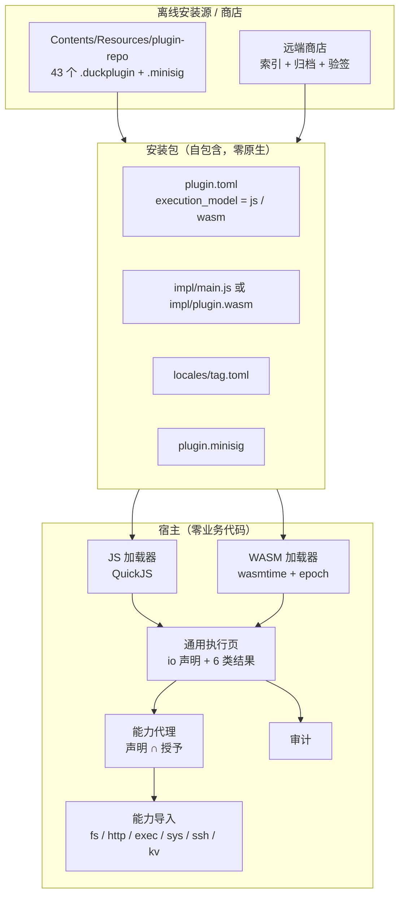
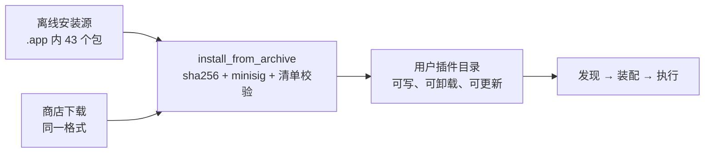

# 插件自包含改造计划（外部模块化 · 全 wasm）

> **一句话**：工具箱（工具目录）下的 43 个工具，全部是「可安装的外部模块」——8 个 JS、
> 35 个 WASM；**包内零原生可执行文件，宿主零业务代码**，碰 OS 的能力（出网 / 子进程 /
> 系统文件）由宿主以「导入」代做。数据库、终端、邮件、AI、项目管理是 app 的内置功能，
> 不占插件位。
>
> 状态：**计划（未实施）**。本文件 **v3**：在 v2（全 wasm 外部模块）之上补 §2.2
> 「视图也是数据」，把宿主最后的页面知识也搬到插件里。

## 0. 变更记录

| 版本 | 变化 | 原因 |
| --- | --- | --- |
| v1 | 存量 35 个走 R1（每插件一个原生二进制），新插件走 R2（wasm） | 当时的判断：R1 改动最小 |
| **v2** | **撤销 R1**：35 个全部迁 wasm；删除 `process` 轨；OS 能力改宿主导入 | 负责人判定：原生二进制随 `.app` 编译分发仍属「内置」，工具必须**全部通过安装**获得完整功能 |
| **v3** | 新增 §2.2：**视图即数据**（`view(state) → 节点树` + `action` 回传），宿主只留解释器与组件词表；`tool_run.rs` 2,895 行 → ≤400 行 | 负责人追问「宿主机能否只做加载」：算法早已在 core，残留的「业务」其实是**页面知识**（2 种布局 × 6 类结果 × 300 个参数） |

被取代的决策：v1 的 ADR-8（禁止族二进制）、ADR-9（存量 R1 / 新增 R2）。
仍有效：签名强制、随 `.app` 预装（语义改为「离线安装源」）、`api_version` 与 wasm 轨同批。

---

## 1. 边界：什么内置，什么外部

| 类别 | 内容 | 形态 | 是否可卸载 |
| --- | --- | --- | --- |
| **内置功能** | 数据库页（`duck-db` / `duck-drivers`）、终端与 SSH（`duck-term` / `duck-ssh`）、邮件（`duck-mail`）、AI 助手（`duck-ai`）、项目管理（`duck-project`） | app 的页面与服务 | 否 |
| **外部插件** | 工具目录下的 43 个工具（文本 / 编解码 / SQL / 合并 / 比对 / 文件 / 网络 / 杂项 / 金融） | `plugins/<id>/` 安装包 | 是 |

判定口径（可执行）：**能出现在「工具箱 → 工具列表」里的条目，实现必须来自插件包**。
`nav.database` 这类导航条目仍是列表项，但它只做「跳到内置页面」，实现由 app 提供，
不属于插件（保留现状，写进守卫白名单）。

---

## 2. 目标架构



三条不可让步的性质：

1. **包内零原生**：`plugins/*/` 下不得出现 `bin/`、Mach-O / ELF 文件。架构无关 ⇒ 一份包
   通吃 arm64 / x86_64，也不再需要逐个二进制 `codesign` 与公证（包内没有可执行文件，
   Gatekeeper 连拦的理由都没有）。
2. **宿主零业务代码**：`crates/` 不出现 `duck.*.*` 字面量、不依赖 `duck-*-core`；
   宿主只剩加载器、执行页、能力代理、审计。
3. **OS 能力只有导入一条路**：wasm 里没有 socket、没有 `Command`、没有任意路径。
   插件想碰 OS，只能在清单里声明、由宿主代做、留下审计。

### 2.1 轨道：只剩两条

| 轨 | 承载 | 适用 | 数量 |
| --- | --- | --- | --- |
| `js` | QuickJS（进程内沙箱，10 s / 32 MiB） | 纯函数：文本、编码、正则、生成、时间 | 8（现状不动） |
| `wasm` | wasmtime（WASI-p1 + 宿主导入，epoch 中断） | 其余全部：文件、归档、SQL、比对、网络 | 35 → 未来默认 |
| ~~`process`~~ | — | **删除**：不为任何插件产出原生可执行文件 | 0 |

> 为什么留 JS 而不统一成 wasm：这 8 个已经是「包内自带实现」的外部模块，迁移零收益、
> 纯增风险。两种模块类型（脚本 / wasm）是分发系统的常规形态，不是技术债。

### 2.2 视图即数据：宿主只剩解释器

**问题定位**：43 个插件的算法确实已经不在宿主（`crates/duck-app` 零 tool id）。但宿主仍
保留了「页面该怎么长」的完整知识，这才是"只做加载"卡住的地方：

| 宿主位置 | 行数 | 里面是什么 |
| --- | --- | --- |
| `crates/duck-app/src/pages/tool_run.rs` | 2,895 | `ParamKind → 控件`、必填校验、`visible_when` 联动、`params_json` 拼装、`OutputKind → 结果区` 分支 |
| `crates/duck-plugin/src/io.rs` | 1,251 | 2 种页面布局（`Default` / `Job`）、6 类结果、43 份清单里 **300 个参数**的 schema |
| `crates/duck-app/src/pages/*` | — | 页面容器、结果区动作（复制/导出/保存） |

**做法**：把「页面」变成插件返回的数据，宿主退化成 Elm 式解释器。

```
插件： view(state) -> ViewNode          事件： on_event(action, state) -> view(state)
宿主： render(node) -> gpui 元素        派发： on_click/on_input -> action{node, kind, value}
```

四条硬规则：

1. **宿主不认识 state**。`state` 是插件私有、不透明的一段字节（宿主只负责存/取/超时）。
2. **宿主不做数据绑定**。控件不写 `bind = "param.dir"`；输入事件原样带着 `node_id` 回插件，
   由插件算新视图。宿主一旦解释绑定，就又开始认识参数了。
3. **节点词表是闭集**，未知节点/未知 prop 直接报错（不静默降级）。约 18 个：
   - 容器 `stack` `row` `split` `tabs` `section` `card` `scroll`
   - 输入 `text` `textarea` `number` `select` `toggle` `path` `table_edit`
   - 输出 `text` `code` `table` `tree` `diff` `preview` `log` `progress` `stat` `empty`
   - 动作 `button` `menu`（宿主内建 `copy` / `export` / `save` / `open`，插件只声明）
4. **页面原型不是宿主分支**。审计文档里的 A–F 六种骨架（单列 / 双栏 / Tab+表格 / 长任务 /
   设置 / 工作台）全部由词表组合表达 ⇒ `IoLayout::{Default, Job}`、`FieldsLayout` 这类
   枚举随之删除，`tool_run.rs` 不再有"第几种页面"的判断。

**向后兼容**：v2 清单的 `[tools.io]` 继续有效 —— 宿主提供 `io::compile_view()`，把现有
`params` / `output` 声明**编译成**一份默认视图树。8 个 JS 插件与 43 份清单**零改动**启动；
新插件可以不写 `io`，直接给 view。迁移是"逐页替换视图来源"，不是一次性切换。

**成本与坑**：

- 每键一次 wasm 调用：视图树 ~10–100 KB JSON，调用本身 µs 级；宿主做**结构 diff + 稳定
  `node_id`**，输入控件保留本地回显（受控框只在 `render` 入口回写，沿用既有纪律）。
- 富控件（可编辑表格、拖拽排序、树预览）要在词表里**做一次**，43 个插件共享。这是唯一
  的净新增工作量，也是它值得的原因：现在这 6 项能力缺口要按页补 20 次。
- 调试需要 `DUCK_PLUGIN_DEV=1`：把收到的视图树落盘 + 一个 view inspector，否则插件作者
  只能盲调。
- 不允许插件自带 UI 代码（HTML/webview/原生绘制）——那等于把宿主重新变成浏览器，
  主题 token、可访问性、选中复制、IME 全部失守。

**判定标准（写进守卫）**：

| 宿主源码里出现 | 判定 |
| --- | --- |
| 某个 tool id、某类结果"该怎么摆"、某个参数的语义 | **越界**（业务） |
| 节点怎么画、事件怎么派、能力怎么裁、文件面板怎么开 | **内核** |

---

## 3. 宿主导入 ABI（本次真正的核心契约）

wasm 插件通过 WASI 拿到的东西只有：stdin/stdout 与**预开放目录**。其余一切走宿主导入：

| 导入 | 语义 | 授权来源 | 备注 |
| --- | --- | --- | --- |
| `host.log(line, level)` / `host.progress(cur,total,msg)` | 过程事件 | 无 | 替代 stdout JSONL 的写侧 |
| `host.locale()` / `host.t(source)` | 当前语言 + 插件译文 | 无 | 复用宿主 `PluginLocales`，wasm 内不必读 toml |
| `host.kv.get/set` | 插件私有 KV（≤32 KB） | 无 | ADR-4 的快照/回执语义不变 |
| `host.fs.list/read/write(rel, root)` | 授权目录读写 | per-run `[io].allow_files` + 用户选的路径 | 只放本次授权的根，杜绝任意路径 |
| `host.http(req)` | 代发 HTTP | `[capabilities].network_hosts` 精确白名单 | 超时/大小/重定向上限在宿主侧 |
| `host.exec(cmd,args)` | 代起子进程 | `[capabilities].process_exec` 精确命令名 | 逐次确认 + 审计留痕 |
| `host.sys.hosts.read/write` | `/etc/hosts` 专用 | 独立能力位 + 二次确认 | 仅 `misc/hosts-manager` |
| `host.ssh.test(target)` | SSH/SFTP 连通性 | `network_hosts` | 复用宿主 `duck-ssh`，仅 `net/s3-ftp-checker` |
| `host.notify(msg)` | 通知 | `notifications` | 同现状 |

> `host.exec` / `host.sys` 是最大的攻击面。规则：**精确命令名、无通配、无 shell**，
> 每次调用弹确认、写审计；不在白名单里的命令宿主直接拒。

---

## 4. 包格式

`api_version` **不必抬到 3**：`execution_model = "wasm"` 已存在于 v2 清单
（`manifest.rs` 的 `ExecutionModel::Wasm` 一直在解析），本次只是终于有实现。

```
plugins/<id>/
  plugin.toml          # execution_model = "wasm"，不写 [process]
  impl/plugin.wasm     # 构建产物（不入库，打包时生成）
  src/main.rs          # 30–80 行薄壳（只做参数映射 → 内核调用）
  Cargo.toml
  locales/en.toml
  plugin.minisig       # 打包时生成
```

v1 曾计划 `runtime{kind,entry} + targets[]`：**`targets` 在全 wasm 下自动消失**
（一份 wasm 跨平台）。若将来需要表达「最低宿主版本」，只加一个字段：

```toml
[runtime]
host_api = ">=3,<4"     # 可选；缺省视为兼容
```

这条字段的抬版时机与 wasm 轨同批，且不改变既有字段语义（旧客户端拒载新插件可接受，
商店按 `host_api` 过滤可见性）。

### 4.1 「预装」= 离线安装源（不是内置）

`Contents/Resources/plugin-repo/` 放 43 个 `.duckplugin`（tar.gz + minisig）。
首启由**与商店完全相同**的 `install_from_archive` 装到
`~/Library/Application Support/DuckToolbox/plugins/`，同一套校验、同一套落位、
同一套版本记录。这样「通过安装实现完整功能」字面成立，且首启不是空工具箱。



---

## 5. 35 个 process 插件的迁移路线

| 批次 | 插件 | 需要的宿主导入 | 额外工作 |
| --- | --- | --- | --- |
| ① 纯计算（无 IO） | `sql-script-check`、`sql-classifier`、`sql-ddl-generator`、`text-data-format`、`text-random-gen`、`text-cheat-sheets`、`codec-crypto-bundle` | 无 | 直接编 wasm |
| ② 读文件 | `compare/*`（4）、`files/tree`、`files/search`、`files/csv-tools` | `fs` | preopen 改造 |
| ③ 读写文件 + 归档 | `merge/*`（7）、`sql/sql-merge`、`files/batch-edit`、`files/doc-convert`、`finance/*`（2） | `fs` | zip/xlsx/pdf 依赖需过 wasm 编译 |
| ④ 出网 | `net/http-request`、`net/s3-manager` | `http` | `ureq` 换成 `host.http`（唯一需要改逻辑的族） |
| ⑤ 系统能力 | `net/hosts-manager`（`sys`）、`net/packet-send`（`sys` 或下线）、`net/s3-ftp-checker`（`ssh`）、`misc/git-tools`（`exec`） | `sys` / `ssh` / `exec` | 逐个确认是否保留 |

验收方式：**同输入对拍**。用现有 `*-tool/tests/cli.rs` 的用例集，分别跑旧 process 与新
wasm，比对 `result.output` 与 `body` 逐字节一致；不一致即不迁。

---

## 6. 宿主改造清单

| 位置 | 动作 | 验收 |
| --- | --- | --- |
| **新增** `crates/duck-plugin-wasm` | 引擎（wasmtime）、WASI preopen、epoch 超时、取消、9 个导入的宿主实现 | 与 js 轨共用同一份结果合同 |
| `crates/duck-app/src/pages/tool_run.rs`（2,895 行） | 三分支 → 两分支（js / wasm）；**并重写为视图解释器**：删 `ParamKind → 控件`、`visible_when`、`params_json`、`OutputKind` 分支 | ≤400 行；文件内无 `kind` 语义判断 |
| **新增** `crates/duck-plugin/src/view.rs` | `ViewNode` 词表 + JSON schema 校验 + 结构 diff + `io::compile_view()` 兼容编译 | v2 清单零改动仍可渲染 |
| `crates/duck-plugin/src/io.rs`（1,251 行） | 降级为「兼容编译器」，不再被渲染层直接消费；新插件不写 `io` | 渲染层只依赖 `view.rs` |
| `crates/duck-plugin-wasm` 导出面 | 除 `run` 外增加 `view(state)` / `on_event(action)`；js 轨同形（`module.exports.view`） | 两条轨道视图语义一致 |
| **删除** `crates/duck-plugin-process` | 协议（`RunRequest` / `Event`）并入 `duck-plugin::proto`；进程 runner 删除 | `cargo tree` 无 `process` |
| **删除** 8 个 `crates/duck-*-tool` + 35 份 `bin/run` | 全部由 `plugins/<id>` 取代 | `plugins/*/` 下 0 个原生文件 |
| `sbin/plugins.sh` → `sbin/plugins-wasm.sh` | 删 `binary_for`；遍历 `plugins/*/Cargo.toml` 编 `wasm32-wasip1`，产物落 `impl/plugin.wasm` | 加插件只多一个目录 |
| `plugins/Cargo.toml`（新增） | 插件**独立 workspace**；根 `Cargo.toml` 加 `exclude = ["plugins"]` | 根 workspace 不再含插件代码 |
| `crates/duck-plugin/src/lib.rs` | 增加 `proto` 模块（请求/事件），清单加可选 `[runtime].host_api` | v1/v2 清单照常加载 |
| `sbin/package-macos.sh` | 打 43 个 `.duckplugin` + minisig 到 `Contents/Resources/plugin-repo`；**不再拷可执行文件** | 安装包内 0 个原生插件二进制 |
| `crates/duck-app/src/plugins.rs` | 首启从离线源批量安装（后台 + 进度）；双源加载 | 首启 43 个工具可见 |
| `crates/duck-plugin-registry/src/install.rs` | 强制验签；解包上限 64 → 128 MiB | 未签名包安装失败 |
| `AGENTS.md` | 新增 §3.8 插件分发纪律（零原生 / 零业务代码 / 能力导入） | — |

**源码外迁**：`crates/duck-*-core` → `plugins/_core/<fam>-core/`（零 gpui、无 socket、
无 `Command` 的那部分）。`crates/` 最终只剩：`duck-plugin`（清单/io/能力/协议/i18n）、
`duck-plugin-js`、`duck-plugin-wasm`、`duck-plugin-registry`。

---

## 7. 守卫（先红后绿）

| 编号 | 断言 |
| --- | --- |
| G1 | `crates/` 内 0 处 `duck.<family>.<tool>` 字面量；`duck-app` 不依赖任何 `duck-*-core` |
| G2 | `plugins/*/` 下无 `bin/`、无 Mach-O/ELF；`plugin.toml` 不出现 `[process]` |
| G3 | 每个插件实现体存在：`js → impl/main.js`（或根 `main.js`）、`wasm → impl/plugin.wasm` |
| G4 | 打包 dry-run：离线源包数 == 插件数，且每个都有 `.minisig` |
| G5 | 未签名包安装必须失败；已签名必须成功 |
| G6 | 每个插件真跑一遍必须出非空结果（扩 `dev_plugins.rs`，js 与 wasm 同一张表） |
| G7 | `duck-app` 内无 `OutputKind` / `ParamKind` 的 `match`（唯一允许：`view.rs` 的节点→元素表） |
| G8 | 每个插件的视图树过 schema 校验：未知节点 / 未知 prop / 非法嵌套 → 报错，**不静默降级** |
| G9 | `duck-app` 单文件行数上限（`tool_run.rs` ≤ 400）：超了说明页面知识又开始回流宿主 |

---

## 8. 批次

| 批次 | 内容 | 完成标志 | 量 |
| --- | --- | --- | --- |
| **P0** 可行性 | `rustup target add wasm32-wasip1`；9 个 core 逐个试编，记录体积与失败点；wasmtime vs wasmi 选型；ABI 表定稿；G1–G6 骨架 | 迁移批次表定稿（35 是否都能编） | S |
| **P1** 引擎 | `duck-plugin-wasm` + 导入实现；先拿 `text-data-format`（纯计算）打通端到端 | 一个真 wasm 插件在工具页跑出结果 | M |
| **P1.5** 视图层 | `view.rs` 词表 + 解释器 + `compile_view()` 兼容层；拿 3 页试点（`text-timestamp` 单列、`text-diff` 双栏、`sql-merge` 长任务） | 这 3 页的视图完全来自插件，`tool_run.rs` 不再有对应分支 | M |
| **P2** 源码外迁 | `plugins/` 独立 workspace + `_core` 迁移 + SDK 薄壳 | 根 `cargo build` 不再编任何插件代码 | M |
| **P3** 逐批迁移 | 第 ①→⑤ 批，每批「编 wasm → 对拍 → 切清单」 | 旧 process 实现可删 | L |
| **P4** 收口 | 删 process 轨与 8 个 `*-tool`；离线安装源 + 强制验签；守卫全绿；AGENTS 更新 | 发版包：43 个工具、0 个原生插件文件 | M |

> **P1 是分水岭**：只要有一个真实 wasm 插件跑通，「外部模块」这条路就被证明可行，
> 后面的迁移是重复劳动而非技术探索。

---

## 9. 风险

| # | 风险 | 影响 | 缓解 |
| --- | --- | --- | --- |
| 1 | **wasm 编不过**：`pdf-extract`、`calamine`、`zip`、`encoding_rs` 可能有 C 依赖或平台假设 | 相关插件迁不动 | P0 逐个试编；编不过的先用 `host.fs` 把解析搬到宿主？**不允许**（等于业务逻辑回宿主）；退路是该插件降级/下线，需单独拍板 |
| 2 | **性能**：wasm 比原生慢 1.5–3× | 合并/比对大包变慢 | wasmtime cranelift 优化；用现有 `cli.rs` 用例量真实耗时；必要时把热点（zip 解压）走 `host.fs` 批量读 |
| 3 | **内存**：宽限 512 MiB 线性内存，合并超大版本包可能触顶 | 大包失败 | 流式处理 + 分片 `body`；实测定上限 |
| 4 | **`host.exec` 攻击面** | 插件借 git 执行任意命令 | 精确命令名白名单 + 无 shell + 逐次确认 + 审计；不接受参数里的 `;` `|` |
| 5 | **wasmtime 体积** +10–20 MB | `.app` 变大 | 与省下的 35 个原生 bin（120–160 MB）相比是净减；若嫌大可换 `wasmi`（体积小、慢） |
| 6 | **首启装 43 个包** 耗时 | 首启卡顿 | 后台线程 + 进度；已装版本跳过；失败可重试 |
| 7 | **视图往返**：每键一次 wasm 调用 + 全树重建 | 大表单（23 个参数的 `codec-crypto-bundle`）可能顿 | 结构 diff + 稳定 `node_id` + 输入本地回显；插件可声明 `live = false` 只在失焦/blur 回传 |
| 8 | **词表不够用**：6 项能力缺口（可编辑表格 / 工作台 / 预览）需要在词表里补齐 | 20 个 ● 页仍不达标 | 词表按 `plugin-page-archetype-audit.md` 的 A–F 原型一次性设计；缺的组件补成**通用**组件，不写 per-tool 代码 |

---

## 10. 待办

- [ ] P0-1 `wasm32-wasip1` 试编矩阵（9 个 core）
- [ ] P0-2 引擎选型：wasmtime / wasmi
- [ ] P0-3 §3 导入 ABI 评审
- [ ] P0-4 守卫 G1–G6 骨架
- [ ] P1-1 `crates/duck-plugin-wasm`
- [ ] P1-2 首个试点插件（`text-data-format`）
- [ ] P1.5-1 `duck-plugin/src/view.rs`（词表 + schema + diff）
- [ ] P1.5-2 `io::compile_view()` 兼容层（v2 清单零改动）
- [ ] P1.5-3 三页试点：单列 / 双栏 / 长任务
- [ ] P1.5-4 `DUCK_PLUGIN_DEV=1` 视图落盘 + inspector
- [ ] P2-1 `plugins/` 独立 workspace
- [ ] P2-2 `_core` 迁移
- [ ] P3-x 五批迁移 + 对拍（①15 / ②7 / ③12 / ④2 / ⑤4，重叠按实际计）
- [ ] P4-1 删 process 轨
- [ ] P4-2 离线安装源 + 强制验签
- [ ] P4-3 守卫全绿 + AGENTS 更新

## 11. 遗留

1. `net/packet-send`（原始包）在 wasm 下只能走宿主 `host.sys`，安全面过大——建议**下线**，
   待定。
2. 第三方作者写 wasm 插件所需的 SDK 文档与 ABI 版本承诺（P4 后）。
3. `host_import` 的版本演进策略（导入签名变更 = 破坏性 ABI 变更，需 `host_api` 约束）。
4. **视图词表版本化**：`view.rs` 的节点/属性属于 `host_api` 的一部分，新增节点只加不删；
   删除节点 = 破坏性变更（老插件视图直接校验失败）。
5. `table_edit` / 拖拽排序这两类富控件先在词表里做只读版，可编辑版等有第二个人用到再补。
