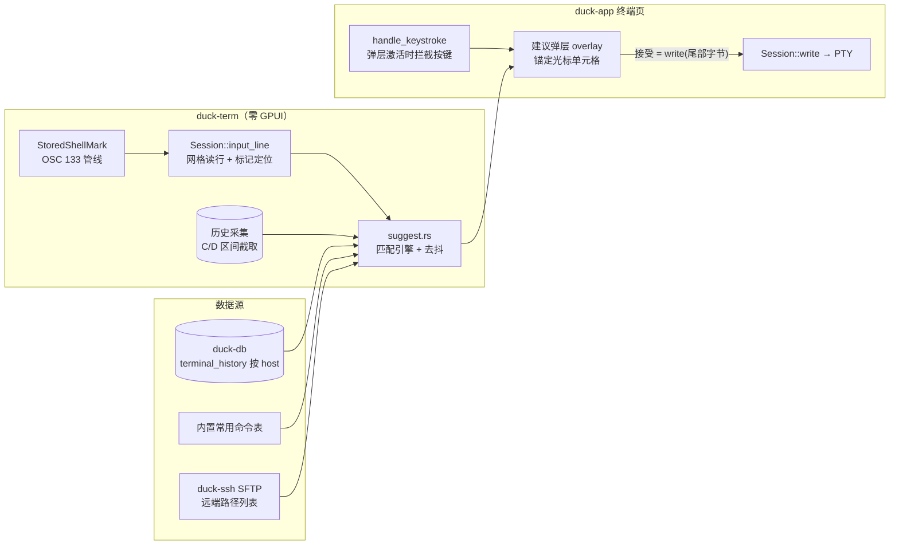

# 终端智能提示（命令自动补全）设计分析

> 状态：**已实施（L0 + L1 全量，L2 注入已落地；SSH 远端路径补全未做）**。
> 实现落点：vendor 补丁（`Event::ShellMark` 带列号）→ `duck-term`
> （`input_line` / `drain_commands` / `suggest` 引擎）→ `duck-app`
> （`terminal/suggest.rs` + `terminal_canvas.rs` 胶水：弹层 / 按键拦截 /
> 历史采集 / L2 注入）。设置：「会话」节的「智能提示」（默认开）与
> 「注入 shell 集成脚本」（默认关）。接受键位：`→` 与 `Tab` 都开；
> 历史按 host 隔离。SSH 远端路径补全需走 SFTP 异步通道，留待后续。

## 1. 问题本质

PTY 终端是**字节透传**：应用把按键编码成字节写进 PTY（`keymap::encode` →
`Session::write`），远端/本地 shell 独占行编辑器。**应用从来看不到"用户正在
输入什么"** —— 这些字符只以回显形式出现在网格里。

所以智能提示的第一性问题不是"候选从哪来"，而是**"如何重建当前输入行"**。
业界三条路线全部围绕这一点分岔。

## 2. 参考项目调研结论（temp/）

| 项目 | 有无输入补全 | 与本任务相关的可借鉴点 |
| --- | --- | --- |
| **tabby** | 核心仓库没有 —— 补全是独立社区插件 | ① 插件做法：从 xterm 缓冲区**读当前行** + 历史匹配 + DOM 弹层，`→`（End）接受；② tabby 另发独立的 shell-integration 脚本包注入 bash/zsh，报提示符边界 —— 即"客户端注入 shell 集成"路线 |
| **oxideterm** | 无按键级补全 | ① **OSC 133 shell 标记管线**（A/B/C/D → `ShellMark` → 提示符竖条 UI）—— duck-term 已继承这套（见下）；② `terminal-semantic` 做的是**输出**语义分类，不碰输入；③ AI suggestions 是聊天层，非 shell 输入 |
| zedis / starship / tiny-rdm 等 | 无 | 无可借鉴的输入补全 |

结论：temp 里没有现成的完整实现可直接抄，但**两条互补的基础设施**都验证过：
tabby 验证了"读网格 + 弹层 + 字节回填"的客户端路线；oxideterm/本仓已具备
OSC 133 标记管线。

## 3. 本仓已有的地基（比预想好）

- **OSC 133 已解析**：vendored alacritty `term/mod.rs:2514` 处理 `133;A/B/C/D`，
  `duck-term/src/session.rs` 存为锚点相对的 `StoredShellMark`，并已有
  `shell_marks_in()` / `prompt_bars()`（应用层**尚未消费**，纯基础设施就位）。
- **网格与光标访问**：`Session::with_term` 给 `&mut Term`，可取
  `grid().cursor().point` 与任意行文本；`term_mode()` 能判 `ALT_SCREEN`。
- **按键拦截点唯一**：`terminal_canvas.rs` 的 `handle_keystroke`（~1755 行）
  `encode(KeyStroke)` → `session.write`。弹出层激活时在此**截下** ↑/↓/→/Tab/Esc。
- **回填通道现成**：接受候选 = 把"建议尾部"字节 `Session::write` 进 PTY ——
  shell 自己完成行编辑，无需理解行缓冲。
- **远端目录列表现成**：duck-ssh SFTP 通道可复用做**路径补全**数据源。
- **本地库现成**：duck-db 可放命令历史表；duck-store kv 放设置。

## 4. 技术路线对比

| 路线 | 原理 | 优点 | 缺点 | 采用者 |
| --- | --- | --- | --- | --- |
| **A. 网格读行**（客户端启发式） | 从网格读光标行（提示符判定用启发式/OSC 133 标记），匹配建议，接受时写字节 | 零配置，SSH 到任何服务器都工作；纯客户端 | 提示符判定靠猜（无标记时）；长行折行要拼 | tabby 插件 |
| **B. shell 集成注入** | 客户端向 shell 注入脚本，shell 主动报告提示符边界 / 命令行 / cwd（OSC 133 + 633 类） | 精确、还能拿 cwd 与退出码 | 依赖服务器 shell 类型；未集成则完全失效；注入动作本身有侵入性 | VS Code / iTerm2 / WezTerm / Warp / tabby |
| **C. 客户端接管行编辑** | 弹层时拦截所有按键，自己维护输入行，确认后整行写入 | 弹层体验最强（改词、删词） | 与 shell 行编辑冲突最大；括号补全/语法高亮/多行编辑全要自己做；破坏原生体验 | Warp（封闭生态） |

**推荐：A 为底座 + B 为增强**（C 明确不采用）：

- **L0（默认可用，零配置）**：网格读行 + 启发式提示符判定 + 本地历史/内置
  常用命令两个数据源。
- **L1（自动增强，无需开关）**：检测到 shell 已发 OSC 133（很多服务器用户
  已装 starship/bl abrupt 等）→ 提示符边界精确化；且在 `C/D` 之间**自动采集
  命令历史**（含退出码），历史建议质量大幅提升。
- **L2（可选开关，逐会话自动探测）**：会话空闲在提示符处时注入一段自带的
  shell 集成片段（bash `PROMPT_COMMAND` / zsh `precmd` + ZLE widget），把
  **实时命令行与 cwd** 用私有 OSC（对齐 VS Code `633;E` 语义）报回来 →
  补全精确到"编辑中"的行，且路径补全有 cwd 锚点。

分级的关键收益：**L0 保证"开箱即用"，L1/L2 只提高质量、永远不阻塞**。

## 5. 总体架构

数据流（每次网格 Wakeup，去抖到帧）：

1. `Session::input_line()` 读「提示符结束标记（或启发式行首）→ 光标」的文本；
2. 匹配引擎按 `前缀 → 历史 → 内置命令 →（L2）路径` 出前 N 条；
3. 弹层画在光标单元格上方（几何用现有 `CellSize` 换算）；
4. 用户 `→`/`Tab` 接受 → `write(建议与当前输入的差集)`；继续打字 = 缩小过滤。

## 6. 集成点清单（实施时逐条对表）

| 文件 / 模块 | 改动 | 说明 |
| --- | --- | --- |
| `duck-term/src/session.rs` | + `input_line()`、`cursor_point()`、`at_shell_prompt()` | `with_term` 内实现；提示符判定 = 有 B 标记用标记，否则启发式（光标在末屏最后一行行尾 + 行首匹配提示符正则缓存的宽度） |
| `duck-term/src/suggest.rs`（新） | 匹配引擎（纯函数） | 零 GPUI，可单测；建议项含 `insert_suffix`（差集）与来源标签 |
| `duck-term/src/session.rs` 事件 | + `SessionEvent::CommandCaptured(String, Option<i32>)` | OSC 133 `C/D` 区间截取命令文本；应用层落历史库 |
| `duck-app/pages/terminal_canvas.rs` | `handle_keystroke` 前置弹层分支 | 弹层开着且命中导航键 → `cx.stop_propagation()`；普通字符照旧透传并刷新过滤 |
| `duck-app/pages/terminal/`（新 `suggest_ui.rs`） | 弹层 overlay 组件 | 锚定光标单元格；行 = 图标 + 文本 + 来源；受控状态放 `TerminalSession` |
| `duck-db` | + `terminal_history` 表 | 按 host 维度；上限滚动清理；SSH 键 = destination，本地 = `localhost` |
| `duck-ssh` | L2 注入器（`shell_integration.rs`） | 仅在会话空闲于提示符时发送；探测 `$SHELL`；脚本资源进 `gpui-kit-assets` |
| 设置（`module_settings.rs`） | 总开关 + L2 开关 | 默认 L0+L1 开；安全闸门风格：不出"上报/云同步"类选项 |

## 7. 关键风险与边界

- **全屏应用必须静默**：`term_mode().contains(ALT_SCREEN)`（vim/top/htop）→
  弹层与拦截一律禁用。这是硬闸门，不是启发式。
- **提示符误判**（L0 无标记时）：宁可漏弹不可乱弹；弹层只在
  「光标行有字符且光标在行尾附近」时出现。
- **粘性窗口**：`clear`/Ctrl-U 后输入行为空 → 建议立刻清空。
- **IME / 中文**：输入经 IME 上屏后以 `key_char` 整段到达，网格读行天然
  兼容；建议匹配按 Unicode 字符而非字节。
- **折行**：输入行可能占多行网格行 → `input_line` 从标记/折行起点拼到光标。
- **性能**：每次 Wakeup 只读一行网格 + 前缀匹配（历史表有 host 前缀索引），
  去抖到帧；不建 GPU 侧任何新状态。
- **注入安全（L2）**：只把脚本发进**用户明确开启 L2** 的会话；vim 会话中
  绝不发送（ALT_SCREEN 闸门天然覆盖）；脚本内容静态、可审计。
- **不接受补全时零副作用**：透传路径字节序与现状完全一致（回归
  `tests.rs` 全部按键用例）。

## 8. 建议实施顺序

| 里程碑 | 内容 | 可验证产物 |
| --- | --- | --- |
| **M1** | `input_line()` + 匹配引擎 + 历史表 + 弹层 UI（L0） | 本地终端打 `git ` 弹出历史候选；`→`/`Tab` 接受 |
| **M2** | OSC 133 命令自动采集 + 标记精化提示符判定（L1） | 装了 starship 的服务器上提示符判定零误判；历史自动积累 |
| **M3** | SFTP 路径补全 + L2 shell 集成注入（探测 bash/zsh） | `cd <Tab>` 列远端目录；注入后编辑中即有精确建议 |

M1 完成即"智能提示"可用；M2/M3 渐进增强。

## 9. 待确认

1. 接受键位：`→`（fish 风）还是 `Tab`？还是两者都开（推荐）？
2. 历史是否跨 host 共享（推荐：按 host 隔离，仅内置命令表全局）？
3. L2 shell 集成注入是否进入首版范围（建议放 M3，先验证 L0/L1 手感）？
